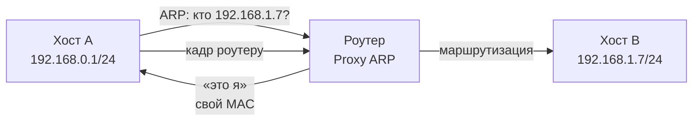

# Proxy_ARP

> [!abstract] Кратко
> Роутер отвечает на ARP-запросы за хосты из другой подсети своим MAC-адресом. Устройство думает, что сосед — в его сети, а трафик фактически идёт через роутер. Спасает от ошибочных масок, но маскирует топологию и открывает вектор спуфинга.

## 1. Зачем нужно
Понять механизм, который «прячет» границы подсетей: почему пингуется хост из другой сети, хотя маска говорит «он рядом» — и чем это опасно.

## 2. Простыми словами
Ты кричишь «кто 192.168.0.7?», а за тебя отвечает почтальон (роутер): «Я!» — и потом доставляет письма адресату. Ты не узнаёшь, что живёшь через дорогу от него, а не в одном подъезде.

## 3. Технические детали

**Сценарий:**

1. Хост A (`192.168.0.1/24`) хочет пинговать B (`192.168.1.7/24`).
2. A считает: B — в той же подсети (такая маска), шлюз не нужен.
3. A шлёт ARP-запрос broadcast: «кто 192.168.1.7?».
4. Роутер с включённым **Proxy ARP** видит: B — за мной, в другой подсети.
5. Роутер отвечает **своим MAC-адресом** на адрес B.
6. A отправляет кадр роутеру, роутер маршрутизирует на B.

**Когда нужен:**
- Хосты со старыми масками, не поддерживающие деление на подсети.
- hosts, которым нельзя прописать шлюз (legacy, встраиваемые устройства).

**Когда вреден:**
- Маскирует реальную топологию: сети «сливаются» на виду у клиентов.
- Трафик между подсетями идёт по L2-заголовку роутера — диагностика запутывается.
- Атака: злоумышленник тоже отвечает на ARP-запросы (как и роутер) — перехват.

Схема:



- **Читать схему:** A шлёт ARP-запрос, роутер отвечает за B. A думает, что B в его сети — на деле кадр идёт роутеру.

## 4. Пример / команда
Проверка Proxy ARP:

```bash
arp -a                  # у A запись: 192.168.1.7 → MAC роутера
show ip interface g0/0  # Cisco: Proxy ARP enabled/disabled
no ip proxy-arp         # отключить на интерфейсе
```

## 5. Для ИБ

| Риск | Защита |
|------|--------|
| Proxy ARP маскирует границы → ложная картина сети | Отключить `no ip proxy-arp` на всех интерфейсах |
| ARP-спуфинг конкурирует с Proxy ARP → MITM | DAI, статические записи ARP для шлюза |
| Легаси-хост без шлюза → Proxy ARP необходим | Правильные маски, статические записи, документация |
| Трафик идёт «мимо» политик L3 → аудит не видит маршрут | Мониторинг ARP-таблицы, NetFlow |

## 6. Вопросы для самопроверки
1. Что делает Proxy ARP?
2. Почему хост шлёт ARP вместо обращения к шлюзу?
3. Чем Proxy ARP полезен и чем опасен?
4. Как отключить Proxy ARP на Cisco?
5. Как Proxy ARP взаимодействует с ARP-спуфингом?

## Связи
- [[ARP_в_локальной_сети]]
- [[Протокол_ARP]]
- [[Маршрутизация]]
- [[Межвлановая_Маршрутизация]]
- [[Конфликт_Масок]]
