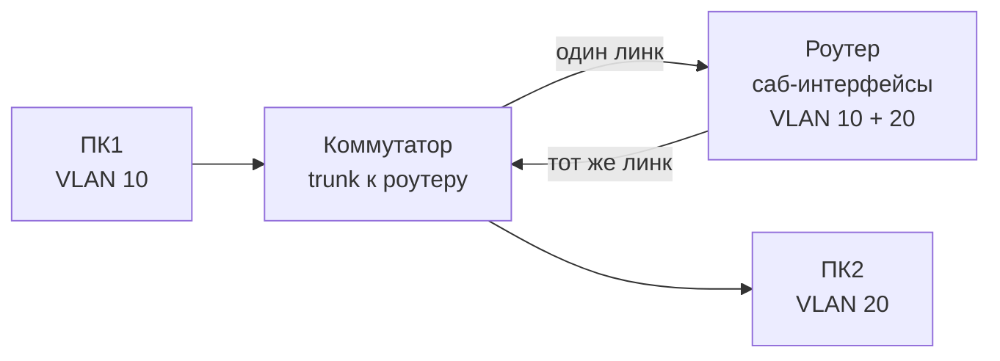

# Router_on_a_Stick

> [!abstract] Кратко
> Маршрутизация между VLAN через один физический интерфейс роутера с несколькими саб-интерфейсами. Трафик дважды проходит через один линк. Один MAC на несколько IP.

## 1. Зачем нужно
Понять, как маршрутизировать между VLAN, когда интерфейсов на роутере мало.

## 2. Простыми словами
Одна дверь из дома, но внутри неё — несколько квартирных звонков. Роутер стоит в одной комнате, а трафик ходит туда-обратно по одному коридору.

## 3. Технические детали
- **Саб-интерфейс (subinterface)** — логический интерфейс внутри физического, для разделения трафика.
- **Один MAC на несколько IP** — при нескольких саб-интерфейсах используется один MAC.
- **Трафик дважды проходит через один физический интерфейс** — отсюда «на палочке».

Ход ping (ARP уже выполнен):

1. **ICMP-запрос** — ПК1 → коммутатор → роутер (меняет MAC) → обратно к коммутатору → ПК2.
2. **ICMP-ответ** — ПК2 → коммутатор → роутер (меняет MAC) → коммутатор → ПК1.



- **Читать схему:** один физический линк между коммутатором и роутером. По нему идут оба VLAN с тегами. Роутер принимает, меняет MAC, отправляет обратно.

## 4. Пример / команда
Настройка саб-интерфейсов:

```bash
interface GigabitEthernet0/0.10
 encapsulation dot1Q 10
 ip address 192.168.10.1 255.255.255.0
interface GigabitEthernet0/0.20
 encapsulation dot1Q 20
 ip address 192.168.20.1 255.255.255.0
```

## 5. Для ИБ

| Риск | Защита |
|------|--------|
| Trunk без ограничения VLAN → утечка | `switchport trunk allowed vlan` |
| Native VLAN 1 → VLAN hopping | Сменить native VLAN, DTP off |
| Один линк → единая точка отказа | Резервный линк, LACP |
| Саб-интерфейс без ACL → плоскость | ACL на саб-интерфейсах |

## 6. Вопросы для самопроверки
1. Что такое саб-интерфейс?
2. Почему «на палочке»?
3. Сколько MAC используется?
4. Сколько раз трафик проходит через линк?
5. Когда используют Router-on-a-Stick?

## Связи
- [[Маршрутизация_через_Маршрутизатор]]
- [[Межвлановая_Маршрутизация]]
- [[VLAN]]
- [[Коммутатор_L3]]