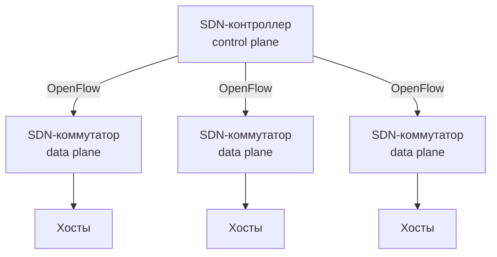

# SDN

> [!abstract] Кратко
> SDN — программно-управляемая сеть: control plane отделён от data plane, вся логика на контроллере. Устройства работают с потоками, не с пакетами. Плюсы: централизация, автоматизация, независимость от вендора. Минусы: контроллер — единая точка отказа и мишень.

## 1. Зачем нужно
Понять, почему крупные ЦОД переходят от распределённой сети к централизованной.

## 2. Простыми словами
Раньше каждый коммутатор сам решал, куда слать пакет. Теперь один «мозг» говорит всем, что делать. Быстро и централизованно, но мозг один — упал, и всё встало.

## 3. Технические детали

- **Ключевая идея:** физическое разделение **control plane** (управление) и **data plane** (передача).
- **Контроллер** собирает информацию о сети и определяет обработку трафика. Устройства следуют инструкциям.
- **OpenFlow:** протокол взаимодействия контроллера с устройствами (ONF, 2011).
- **OpenDaylight:** структура от Cisco, Citrix, IBM.

| Традиционный коммутатор | SDN-коммутатор (OpenFlow) |
|---|---|
| Работает с каждым пакетом | Работает с **потоками** |
| MAC-таблица | **Таблица потоков** с приоритетами |

| ✅ Плюсы | ❌ Минусы |
|---|---|
| Централизованное управление | Контроллер — единая точка отказа |
| Автоматизация через API (Northbound) | Контроллер — мишень для атак |
| Независимость от вендоров (OpenFlow) | Стоимость замены оборудования |
| Адаптивность | Сложность интеграции legacy |
| — | Стандартизация не завершена |

Схема:



- **Читать схему:** контроллер сверху управляет всеми коммутаторами. Коммутаторы только передают данные по инструкциям.

## 4. Пример / команда
Проверка OpenFlow:

```bash
ovs-ofctl dump-flows br0
ovs-vsctl show
```

## 5. Для ИБ

| Риск | Защита |
|------|--------|
| Контроллер скомпрометирован → вся сеть | Изоляция management-сети, 2FA, аудит |
| Нет резерва контроллера → отказ | Кластер контроллеров |
| OpenFlow без TLS | TLS между контроллером и коммутаторами |
| API без аутентификации | mTLS, RBAC |

## 6. Вопросы для самопроверки
1. Что такое SDN?
2. Что разделяется в SDN?
3. Что делает контроллер?
4. Что такое OpenFlow?
5. Главный минус SDN?

## Связи
- [[SD_WAN]]
- [[Overlay_сети]]
- [[ЦОД]]
- [[Clos_топология]]
