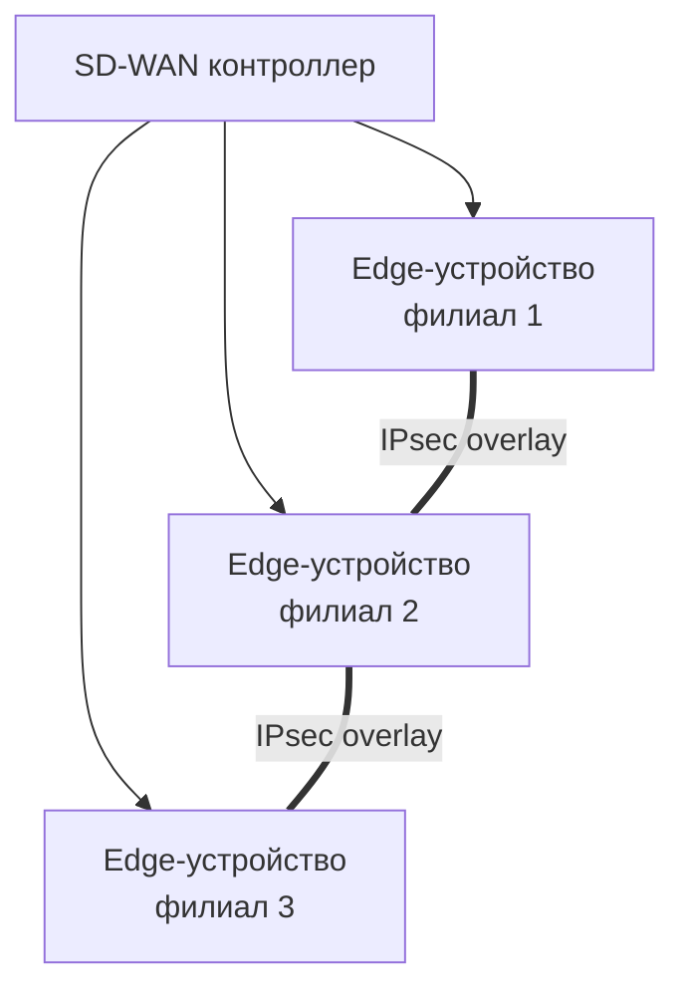

# SD_WAN

> [!abstract] Кратко
> SD-WAN — программно-определяемая WAN для связи удалённых офисов с единым управлением через контроллер. Не стандарт, а общий термин. Плюсы: шаблоны, централизованное распределение трафика, мониторинг. Минусы: миграция с MPLS, зависимость от интернета, расходы.

## 1. Зачем нужно
Понять, как SDN-подход применяется к связи филиалов — там, где MPLS дорого и медленно.

## 2. Простыми словами
Вместо настройки каждого офиса вручную — шаблон с контроллера. Новый филиал подключил и забыл.

## 3. Технические детали

- **SD-WAN** — программно-определяемая WAN-сеть для связи удалённых офисов с единым управлением через контроллер.
- **Не стандарт**, а общий термин, не принадлежит вендору.
- **Контроллеры:** vManage, vBond, vSmart (Cisco).

| ✅ Плюсы | ❌ Минусы |
|---|---|
| Шаблоны вместо настройки «с нуля» | Сложность миграции с MPLS |
| Централизованное распределение трафика | Нужна доп. защита |
| Мониторинг в реальном времени | Зависимость от качества интернета |
| — | Чувствительные приложения (VoIP) страдают от задержек |
| — | Расходы на лицензии, edge-устройства (vCPE), специалистов |
| — | Отказ контроллера → ограничение управления |

- **SD-WAN — не панацея.** Требует планирования и учёта рисков.
- **Оверлейные туннели** (часто IPsec) поверх MPLS/Internet/LTE.

Схема:



- **Читать схему:** контроллер управляет edge-устройствами. Между филиалами — оверлейные туннели поверх любых каналов.

## 4. Пример / команда
Проверка туннелей:

```bash
show sdwan control connections
show sdwan bfd sessions
```

## 5. Для ИБ

| Риск | Защита |
|------|--------|
| Контроллер скомпрометирован → все филиалы | Изоляция, 2FA, аудит |
| Оверлей без шифрования | IPsec, сертификаты |
| Edge без защиты | Hardening, патчи, firewall на edge |
| Нет резерва контроллера | Кластер, локальные политики |

## 6. Вопросы для самопроверки
1. Что такое SD-WAN?
2. Чем отличается от SDN?
3. Три контроллера Cisco?
4. Главный минус?
5. Что используют для туннелей?

## Связи
- [[SDN]]
- [[Overlay_сети]]
- [[LAN_MAN_WAN]]
- [[Иерархия_операторов_Tier]]
