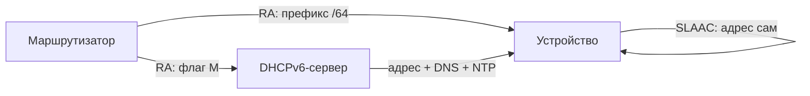

# SLAAC_DHCPv6

> [!abstract] Кратко
> SLAAC — устройство само генерирует адрес из префикса RA. DHCPv6 — централизованная выдача адресов и параметров. Stateful DHCPv6 — полный контроль, Stateless — только доп. параметры (DNS, NTP).

## 1. Зачем нужно
Понять, как IPv6-адреса появляются на устройствах без ручной настройки.

## 2. Простыми словами
SLAAC — «сам себе выдал адрес по подсказке роутера». DHCPv6 — «адрес выдал сервер, вместе с DNS и NTP».

## 3. Технические детали

**SLAAC:**

- Устройство получает префикс сети от маршрутизатора через **RA (Router Advertisement)**.
- Само создаёт глобальный IPv6-адрес: префикс + MAC (EUI-64) или случайные числа (Privacy IPv6).
- Настраивает Link-Local адрес.

**Недостатки SLAAC:**

- Нет управления параметрами (DNS, NTP не передаются).
- Случайные адреса усложняют диагностику.
- Нет статических адресов через SLAAC.

**DHCPv6:**

| Тип | Как работает |
|---|---|
| **Stateful** | Сервер полностью управляет: выдаёт адреса, DNS, NTP |
| **Stateless** | Адреса через SLAAC, сервер даёт только доп. параметры (DNS, домены) |

Схема:



- **Читать схему:** RA даёт префикс. Флаг M (managed) говорит «иди к DHCPv6 за полной конфигурацией». Без флага — SLAAC.

## 4. Пример / команда
Проверка:

```bash
ip -6 addr show
rdisc6 eth0          # Linux: RA
systemctl status radvd
```

## 5. Для ИБ

| Риск | Защита |
|------|--------|
| Поддельный RA → чужой префикс | RA Guard |
| SLAAC без контроля → случайные адреса | DHCPv6 Stateful |
| DHCPv6 без аутентификации | DHCPv6 auth, привязка к порту |
| Нет DNS через SLAAC → ручная настройка | Stateless DHCPv6 для DNS |

## 6. Вопросы для самопроверки
1. Что делает SLAAC?
2. Что даёт DHCPv6?
3. Stateful vs Stateless?
4. Главный недостаток SLAAC?
5. Какой флаг включает DHCPv6?

## Связи
- [[IPv6]]
- [[Отличия_IPv4_IPv6]]
- [[Multicast_Anycast]]
- [[Проблемы_перехода_IPv6]]
