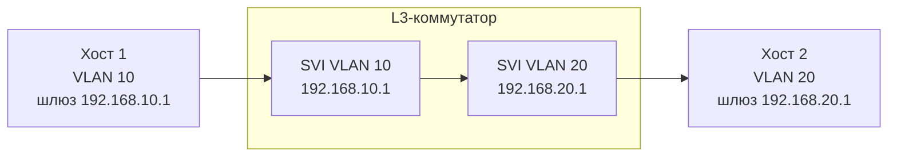

# SVI (Switch Virtual Interface)

> [!abstract] Кратко
> SVI — виртуальный L3-интерфейс на VLAN. Ему назначают IP-адрес, и он становится шлюзом для этой VLAN. Один SVI на VLAN. Живёт внутри L3-коммутатора, наружу не выходит.

## 1. Зачем нужно
Понять, как VLAN получает шлюз и как трафик между VLAN идёт через L3-коммутатор. Без SVI VLAN — изолированная комната без двери.

## 2. Простыми словами
VLAN — комната. SVI — дверь из этой комнаты в коридор (L3). Хосты в VLAN видят дверь как «шлюз по умолчанию» и через неё выходят в другие VLAN и в интернет. Один SVI — одна дверь на одну комнату.

## 3. Технические детали

- **Что это:** логический интерфейс на коммутаторе, привязанный к VLAN. Имеет IP-адрес и маску.
- **Роль:** шлюз по умолчанию для хостов в этой VLAN.
- **Где создаётся:** на L3-коммутаторе или L3+.
- **Сколько:** один SVI на VLAN. На одном коммутаторе может быть много SVI.
- **Отличие от физического порта:** порт смотрит в одну сеть, SVI — в одну VLAN (которая может быть на многих портах и коммутаторах).

| Что | Где живёт | Что делает |
|---|---|---|
| **Access-порт** | Физический порт | Отдаёт кадры без тега в одну VLAN |
| **Trunk-порт** | Физический порт | Передаёт кадры многих VLAN с тегами |
| **SVI** | Внутри коммутатора | Маршрутизирует между VLAN, работает шлюзом |

**Как работает:**
1. Хост в VLAN 10 хочет пинговать хост в VLAN 20.
2. Хост видит, что получатель не в его подсети → шлёт на шлюз (SVI VLAN 10).
3. SVI принимает пакет, коммутатор смотрит таблицу маршрутов, понимает: VLAN 20 — локальная.
4. Пакет уходит в SVI VLAN 20, оттуда — в порты этой VLAN.
5. MAC меняются, IP не меняются.

Схема: SVI как дверь между VLAN.



- **Читать схему:** хост 1 видит шлюз — SVI VLAN 10. Тот передаёт пакет на SVI VLAN 20. Хост 2 получает пакет от своего шлюза.

- **Ключевое отличие от Router-on-a-Stick:** там шлюз — на внешнем роутере, трафик выходит из коммутатора. Здесь шлюз — внутри коммутатора, трафик не выходит.

## 4. Пример / команда
Настройка SVI (Cisco):

```bash
interface vlan 10
 ip address 192.168.10.1 255.255.255.0
 no shutdown
interface vlan 20
 ip address 192.168.20.1 255.255.255.0
 no shutdown
```

Проверка:

```bash
show ip interface brief    # все SVI и их состояние
show vlan brief            # какие VLAN есть
```

## 5. Для ИБ

| Риск | Защита |
|------|--------|
| SVI без ACL → все VLAN видят друг друга | ACL на каждом SVI, явные разрешения |
| SVI в management-VLAN → доступ к управлению из любой VLAN | Отдельная management-VLAN, ACL |
| SVI с широкой маской → большой broadcast-домен | Точные маски, ревизия подсетей |
| SVI без журналирования → непонятно, кто ходит между VLAN | NetFlow/sFlow на SVI |

## 6. Вопросы для самопроверки
1. Что такое SVI?
2. На каком уровне работает SVI?
3. Сколько SVI на одну VLAN?
4. Чем SVI отличается от Router-on-a-Stick?
5. Зачем ACL на SVI?

## Связи
- [[VLAN]]
- [[Коммутатор_L3]]
- [[Коммутатор_L3_Plus]]
- [[Межвлановая_Маршрутизация]]
- [[Router_on_a_Stick]]
- [[Switchport_no_switchport]]