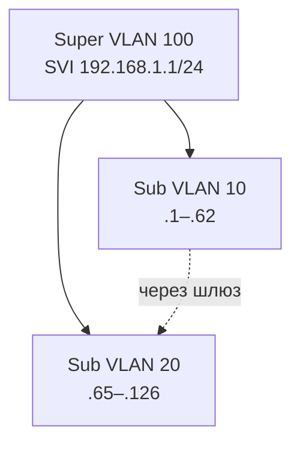

# Super_VLAN

> [!abstract] Кратко
> Super VLAN — механизм объединения нескольких подсетей (Sub VLAN) в одну общую подсеть с общим шлюзом. Экономия адресов: субсети не резать на целые /24. Субсети изолированы друг от друга на L2, связь — через общий шлюз (Super VLAN).

## 1. Зачем нужно
Понять, как экономить адресное пространство, когда устройствам в группе нужно больше, чем влезает в одну маленькую подсеть, но меньше, чем целый /24.

## 2. Простыми словами
Вместо того чтобы отдавать каждому отделу целую улицу с пустующими домами, отдаёшь один большой дом, а внутри — комнаты с общим лифтом (шлюзом). Между комнатами напрямую ходить нельзя — только через лифт.

## 3. Технические детали

- **Super VLAN** — «агрегирующая» VLAN, у которой есть SVI (IP-шлюз), но нет собственных портов.
- **Sub VLAN** — рабочие VLAN, к которым привязаны порты. Своего шлюза нет, используют шлюз Super VLAN.
- **Экономия:** одна общая подсеть, например `192.168.1.0/24`, делится между субсетями без пересечения: VLAN 10 — `.1–.62`, VLAN 20 — `.65–.126` и т.д.
- **Изоляция:** субсети изолированы на L2 (как обычные VLAN). Связь между субсетями — через шлюз Super VLAN (маршрутизация).
- **Proxy ARP:** шлюз отвечает за чужие MAC — субсети «видят» друг друга через него. См. [[Proxy_ARP]].

| ✅ Плюсы | ❌ Минусы |
|---|---|
| Экономия IP-адресов | Не все вендоры поддерживают |
| Общий шлюз для многих субсетей | Шлюз — единая точка отказа |
| Простая масштабируемость: добавил VLAN — добавил диапазон | Нет прямой L2-связи между субсетями (для некоторых задач минус) |

Схема:



- **Читать схему:** шлюз один на все субсети, адреса распределены между субсетями без перекрытия.

## 4. Пример / команда
Настройка (концепт, синтаксис зависит от вендора):

```bash
vlan 100
 supervlan
 subvlan 10,20,30
interface vlan 100
 ip address 192.168.1.1 255.255.255.0
```

## 5. Для ИБ

| Риск | Защита |
|------|--------|
| Субсети изолированы только на L2 — L3-контроль обязателен | ACL на SVI Super VLAN |
| Один шлюз → одна точка отказа | Резервирование, HSRP/VRRP |
| Ошибка в диапазонах → перекрытие адресов | План адресации, IPAM |
| Утечка через Proxy ARP | Контроль ответов Proxy ARP, DAI |

## 6. Вопросы для самопроверки
1. Что такое Super VLAN и Sub VLAN?
2. Зачем нужен общий шлюз?
3. Как экономятся адреса?
4. Почему субсети не видят друг друга напрямую?
5. Как связан Super VLAN с Proxy ARP?

## Связи
- [[VLAN]]
- [[Межвлановая_Маршрутизация]]
- [[Proxy_ARP]]
- [[Маска_Подсети]]
- [[SVI]]
