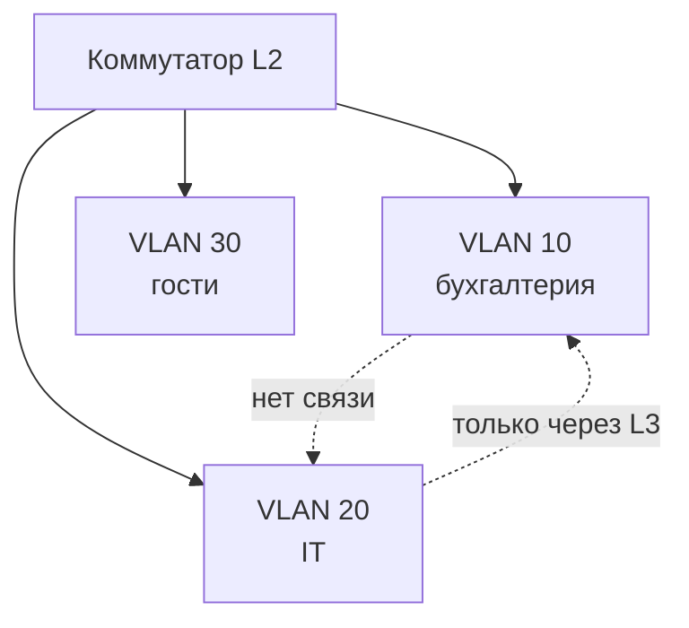

# VLAN

> [!abstract] Кратко
> VLAN — логическое разделение сети на изолированные сегменты на канальном уровне (L2). Один физический коммутатор — несколько виртуальных. Идентификатор — 12 бит VLAN ID (1–4094). Граница VLAN — broadcast-граница. Между VLAN нужен маршрутизатор (L3).

## 1. Зачем нужно
Понять, как сегментировать сеть без прокладки кабелей и покупки новых коммутаторов. VLAN — базовый инструмент сегментации и первый шаг к защите: бухгалтерия не должна видеть трафик серверов.

## 2. Простыми словами
Один дом — несколько подъездов с отдельными дверями. Живёте в одном здании (кабели, коммутатор), но по лестнице из подъезда в подъезд не сходишь — только через улицу (маршрутизатор).

## 3. Технические детали

- **Что такое VLAN:** логическая группа портов/устройств внутри одного физического коммутатора (или нескольких, через trunk).
- **VLAN ID:** 12 бит → 4094 сети (0 и 4095 служебные). Примеры: VLAN 10 — бухгалтерия, VLAN 20 — IT.
- **Границы:** VLAN ограничивает broadcast-домен. Broadcast в VLAN 10 не выходит за её пределы.
- **Межвлановая связь:** только через L3 — маршрутизатор или коммутатор L3. См. [[Межвлановая_Маршрутизация]].
- **Типы портов:** access (один VLAN, без тега) и trunk (несколько VLAN, теги 802.1Q). См. [[Access_vs_Trunk_порты]].

| ✅ Плюсы | ❌ Минусы |
|---|---|
| Сегментация без прокладки кабелей | До 4094 VLAN — мало для облаков (см. [[Overlay_в_ЦОД]]) |
| Уменьшение broadcast-трафика | Настройка на каждом коммутаторе |
| Безопасность: изоляция групп | Межвлановый трафик — нагрузка на L3 |
| Гибкое перемещение пользователей | Ошибка настройки → утечка между VLAN |

**Типы VLAN по назначению:**

| Тип | Назначение |
|---|---|
| **Data** | Трафик пользователей |
| **Voice** | Телефония (приоритизация) |
| **Management** | Управление коммутаторами/серверами |
| **Native** | Кадры без тега на trunk (по умолчанию VLAN 1 — риск) |

Схема:



- **Читать схему:** один физический коммутатор — три изолированных сегмента. Связь между VLAN только через маршрутизацию.

## 4. Пример / команда
Создание и привязка VLAN:

```bash
vlan 10
 name accounting
interface GigabitEthernet0/1
 switchport mode access
 switchport access vlan 10
show vlan brief
```

## 5. Для ИБ

| Риск | Защита |
|------|--------|
| VLAN hopping (двойной тег, DTP) | Отключить DTP, сменить native VLAN, access-режим на портах |
| Management VLAN в общем сегменте | Отдельная VLAN + ACL на доступ |
| Гостевая сеть без изоляции | Гостевая VLAN + запрет доступа к LAN |
| Пересечение VLAN без контроля | Список разрешённых маршрутов на L3 |
| VLAN как «защита навсегда» | VLAN — L2-изоляция, не замена firewall; между VLAN — правила L3 |

## 6. Вопросы для самопроверки
1. Сколько VLAN в 12-битном ID?
2. Что ограничивает VLAN на L2?
3. Как связать две VLAN?
4. Чем access-порт отличается от trunk?
5. Почему native VLAN 1 — риск?
6. Является ли VLAN полноценным firewall?

## Связи
- [[Access_vs_Trunk_порты]]
- [[Межвлановая_Маршрутизация]]
- [[Super_VLAN]]
- [[Сегментация_Сети]]
- [[Коммутатор_L2]]
- [[Маска_Подсети]]
