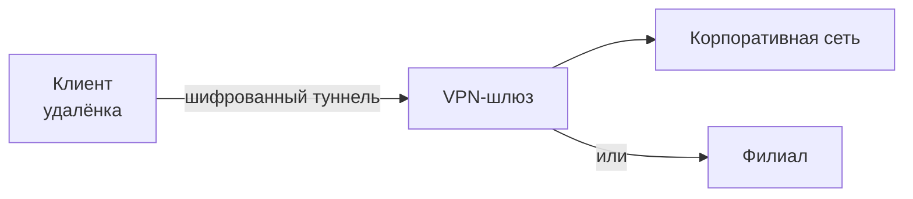

# VPN_как_Overlay

> [!abstract] Кратко
> VPN — оверлей поверх интернета: логическая сеть с шифрованием. Примеры: корпоративный VPN для удалёнки, связь филиалов, домашние VPN, P2P (BitTorrent). Основа — IPsec, TLS, WireGuard.

## 1. Зачем нужно
Понять, как из публичного интернета делают приватную сеть.

## 2. Простыми словами
Труба внутри дороги: едешь по общим улицам, но в своей закрытой трубе, никто не видит, что внутри.

## 3. Технические детали

- **VPN** — виртуальная частная сеть поверх публичной, с шифрованием.
- **Где применяют:**
  - корпоративный VPN для удалённых сотрудников;
  - связь между филиалами;
  - домашние VPN (обход, приватность);
  - P2P (BitTorrent) — динамические оверлеи.
- **Технологии:** IPsec, TLS/SSL VPN, WireGuard, OpenVPN.

Схема:



- **Читать схему:** клиент поднимает туннель до шлюза. Внутри туннеля — приватный трафик поверх публичного интернета.

## 4. Пример / команда
Проверка туннеля:

```bash
ipsec status
wg show
```

## 5. Для ИБ

| Риск | Защита |
|------|--------|
| Слабый VPN → перехват | IKEv2, сертификаты, MFA |
| VPN без split tunneling → весь трафик через шлюз | Явные политики |
| Утечка DNS вне туннеля | DNS через VPN, блокировка |
| Старый протокол (PPTP) | Только современные (WireGuard, IKEv2) |

## 6. Вопросы для самопроверки
1. Что такое VPN?
2. Зачем шифрование?
3. Где применяют VPN?
4. Какие технологии?
5. Чем опасен слабый VPN?

## Связи
- [[Overlay_сети]]
- [[SD_WAN]]
- [[Firewall]]
- [[LAN_MAN_WAN]]
