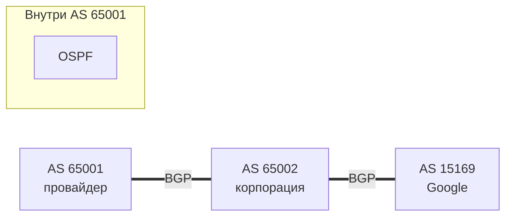

# Автономная_система

> [!abstract] Кратко
> AS — «паспорт» сети, уникальный номер. Публичные AS выдаёт RIR, частные — 64512–65534. Внутри AS — OSPF, между AS — BGP.

## 1. Зачем нужно
Понять единицу, из которой состоит интернет. Интернет — не одна сеть, а миллионы AS.

## 2. Простыми словами
AS — это город с собственным гербом. Внутри города свои улицы (OSPF), между городами — договоры о дорогах (BGP).

## 3. Технические детали

- **AS** — автономная система, «паспорт» сети. У каждой AS уникальный номер (например, AS15169 — Google).
- **Публичные AS** выдаёт регулятор (RIR).
- **Частные AS** — для внутренних нужд, диапазон **64512–65534**.
- **Для локальных сетей** предпочтительнее OSPF, не BGP.
- **Изолированные сети** (не связанные с интернетом) могут использовать любые номера.

Схема:



- **Читать схему:** внутри AS — OSPF, между AS — BGP. Каждая AS — отдельный «город» со своим номером.

## 4. Пример / команда
Проверка AS:

```bash
whois -h whois.radb.net 8.8.8.8    # номер AS
show ip bgp summary                # BGP-сессии
```

## 5. Для ИБ

| Риск | Защита |
|------|--------|
| Угон AS-номера | RPKI, ROA |
| BGP без аутентификации | MD5/SHA, prefix-list |
| Частная AS «протекла» в интернет | Фильтрация частных AS на границе |
| Нет документации AS | Реестр, RIR-записи |

## 6. Вопросы для самопроверки
1. Что такое AS?
2. Кто выдаёт публичные AS?
3. Диапазон частных AS?
4. Что используют внутри AS?
5. Что используют между AS?

## Связи
- [[BGP]]
- [[Иерархия_операторов_Tier]]
- [[LAN_MAN_WAN]]
- [[Динамическая_Маршрутизация]]
