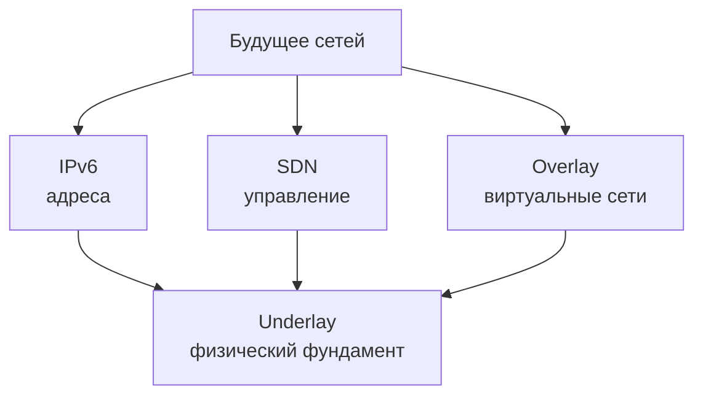

# Будущее_сетей

> [!abstract] Кратко
> Будущее — не победа одной технологии, а сочетание: IPv6 (адреса для IoT), SDN (централизованное управление), Overlay (гибкие виртуальные сети). Underlay остаётся критическим фундаментом. Старые технологии не умирают сразу.

## 1. Зачем нужно
Понять, куда движутся сети и что учить дальше. Без этого знания быстро устаревают.

## 2. Простыми словами
Не «одна дорога победит все», а «город с разными дорогами»: где-то магистраль, где-то переулок, где-то объезд.

## 3. Технические детали

| Технология | Роль |
|---|---|
| **IPv6** | Огромное адресное пространство для IoT и сервисов |
| **SDN** | Централизованное, автоматизированное управление |
| **Overlay** | Гибкие изолированные виртуальные сети (независимо от IPv4/IPv6) |

- **Underlay остаётся критически важным фундаментом.** Новые технологии постепенно вытесняют старые, но не мгновенно.
- **Старые протоколы не умирают** — привычка и проверенность важны.
- **Рядовому пользователю всё равно** — главное, чтобы видео грузилось.

Схема:



- **Читать схему:** все три технологии опираются на физический underlay. Без него ничего не работает.

## 4. Пример / команда
Проверка трендов на своём устройстве:

```bash
ip -6 addr show
curl -6 https://ifconfig.co
```

## 5. Для ИБ

| Риск | Защита |
|------|--------|
| Новые технологии без защиты | Приравнять к старым по политикам |
| Overlay/SDN в обход правил | DPI, контроль контроллеров |
| IPv6 «экспериментальный» → слабые политики | Явные правила для IPv6 |
| Нет обучения персонала | Курсы, лабы, документация |

## 6. Вопросы для самопроверки
1. Три технологии будущего?
2. Что остаётся фундаментом?
3. Почему старые технологии не умирают?
4. Что важнее всего для пользователя?
5. Что учить дальше?

## Связи
- [[IPv6]]
- [[SDN]]
- [[Overlay_сети]]
- [[Итоги_цикла_сети]]
