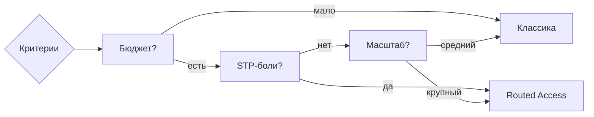

# Выбор_архитектуры_маршрутизации

> [!abstract] Кратко
> Две архитектуры: классическая (маршрутизация на Distribution) и routed access (маршрутизация на Access). Критерии выбора: масштаб, STP-боли, бюджет, существующая база. Гибрид допустим.

## 1. Зачем нужно
Свести сравнение в одну заметку — чтобы выбор был осознанным, а не «как у соседа».

## 2. Простыми словами
Классика — все пересадки в одном узле (просто, но скученно). Routed access — пересадки на каждом этаже (гибко, но дорого).

## 3. Технические детали

| Критерий | Классика (Dist) | Routed Access |
|---|---|---|
| Масштаб | Средние и большие сети | Большие ЦОД/кампусы |
| STP | Глубокий, риск | Минимум |
| Бюджет | Дешевле Access | Дороже (L3 везде) |
| Сложность | Ниже | Выше (маршруты на каждом) |
| Отказоустойчивость | Отказ Dist — для всех | Локальный отказ |
| Существующая база | Если уже есть Dist | Если Access уже L3 |

**Критерии выбора:**
1. **Масштаб:** малый — всё равно Dist; крупный — по кластерам.
2. **STP-боли:** частые штормы → routed access.
3. **Бюджет:** нет бюджета на L3-коммутаторы access → классика.
4. **Существующая сеть:** редко перестраивают с нуля — чаще гибрид.

**Гибрид:** часть кампуса на классике, новый кластер — routed access. Допустимо, но документируйте границы.

Схема:



- **Читать схему:** сначала бюджет, затем боли STP, затем масштаб. Гибрид — если критерии расходятся.

## 4. Пример / команда
Проверка текущего состояния:

```bash
show spanning-tree summary    # насколько глубокий STP
show ip route summary         # сколько маршрутов
```

## 5. Для ИБ

| Риск | Защита |
|------|--------|
| Смешанная архитектура без документации | Схема границ гибрида |
| Выбор «по моде» → переделка | Критерии в этой заметке |
| Нет планирования отказов | Лаба: убить Dist/Routed-узел и посмотреть |
| Разные политики в гибриде | Единый ACL-фреймворк |

## 6. Вопросы для самопроверки
1. Две основные архитектуры?
2. Главный критерий против STP-болей?
3. Что такое гибрид?
4. Почему редко перестраивают с нуля?
5. Как проверить текущий STP?

## Связи
- [[Маршрутизация_на_Distribution]]
- [[Маршрутизация_на_Access]]
- [[Трехуровневая_модель_сети]]
