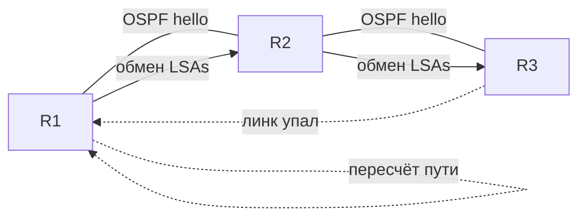

# Динамическая_Маршрутизация

> [!abstract] Кратко
> Маршрутизаторы обмениваются маршрутами автоматически, без ручной настройки каждого. Протоколы: RIP (тупой, 15 хопов), OSPF (link-state, область 0), BGP (между AS, интернет). Автоматически адаптируется к отказам.

## 1. Зачем нужно
Понять, как сети с десятками маршрутизаторов находят пути без ручной настройки каждого маршрута — и почему при отказе линка трафик уходит в обход.

## 2. Простыми словами
Ручная маршрутизация — ты сам рисуешь карту для каждого посыльного. Динамическая — посыльные сами рассказывают друг другу о дорогах: «этот мост сломался — едь через другую реку».

## 3. Технические детали

| Протокол | Тип | Область | Особенности |
|---|---|---|---|
| **RIP** | Distance-vector | Малые сети | Максимум 15 хопов, медленная сходимость, устарел |
| **OSPF** | Link-state | Внутри AS | Быстрая сходимость, области (area 0 — backbone), аутентификация MD5/SHA |
| **BGP** | Path-vector | Между AS | Интернет, политики, всё на доверии (см. [[BGP]]) |

- **Distance-vector:** маршрутизатор передаёт соседям свои таблицы с метрикой («сколько хопов»).
- **Link-state:** каждый маршрутизатор строит полную карту сети и считает пути сам (алгоритм Дейкстры).
- **Административная дистанция** (Cisco): connected — 0, static — 1, OSPF — 110, RIP — 120.

Схема:



- **Читать схему:** маршрутизаторы обмениваются информацией о связях (LSA). Отказ линка — пересчёт маршрутов автоматически.

## 4. Пример / команда
Базовый OSPF:

```bash
router ospf 1
 network 192.168.1.0 0.0.0.255 area 0
show ip ospf neighbor
show ip route ospf
```

## 5. Для ИБ

| Риск | Защита |
|------|--------|
| RIP без аутентификации → впрыск ложных маршрутов | Не использовать RIP, аутентификация |
| OSPF без MD5/SHA → rogue-роутер | Аутентификация соседей |
| Ложные анонсы → трафик к злоумышленнику | Фильтрация, passive-interface |
| BGP без RPKI → угон префиксов | RPKI, prefix-filter (см. [[BGP]]) |

## 6. Вопросы для самопроверки
1. Зачем динамическая маршрутизация?
2. Чем link-state отличается от distance-vector?
3. Что такое area 0 в OSPF?
4. Почему RIP устарел?
5. Что такое административная дистанция?

## Связи
- [[Маршрутизация]]
- [[BGP]]
- [[Маршрутизация_между_двумя_маршрутизаторами]]
- [[Приоритет_маршрутов]]
