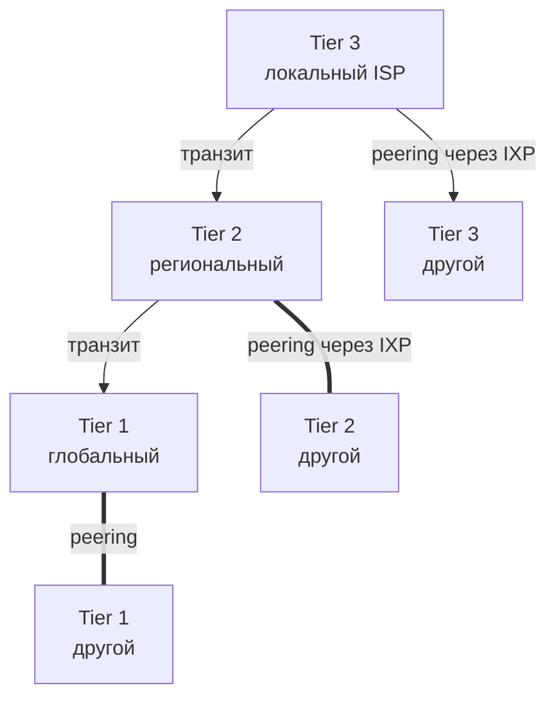

# Иерархия_операторов_Tier

> [!abstract] Кратко
> Tier 1 — глобальные магистрали, peer-to-peer между собой. Tier 2 — региональные, покупают транзит у Tier 1, peering между собой. Tier 3 — локальные, услуги конечным пользователям. IXP — площадки обмена трафиком.

## 1. Зачем нужно
Понять, кто кому платит и как трафик доходит от вашего дома до Google.

## 2. Простыми словами
Tier 1 — федеральные трассы. Tier 2 — областные дороги, платят федералам. Tier 3 — улицы у дома. IXP — перекрёсток, где все встречаются без платы.

## 3. Технические детали

| Tier | Роль | Примеры |
|---|---|---|
| **Tier 1** | Глобальные магистральные провайдеры, peer-to-peer между собой, 400+ Гбит/с | Lumen, AT&T, NTT |
| **Tier 2** | Региональные, покупают транзит у Tier 1, peering между собой | Ростелеком, Cogent |
| **Tier 3** | Локальные/розничные, услуги конечным пользователям | Местные ISP |

- **IXP (Internet Exchange Point):** площадка обмена трафиком между провайдерами и компаниями. Компоненты: коммутаторы L2/L3, роутеры участников. Примеры: DE-CIX (Германия, крупнейший), MSK-IX (Россия).
- **Пиринг (Peering):** взаимный обмен трафиком без оплаты. Публичный (через IXP) или приватный (прямой линк).
- **Транзит:** одна сеть платит другой за доступ к интернету.

Схема:



- **Читать схему:** вверх — транзит (платно), по горизонтали — пиринг (бесплатно). IXP соединяет равных.

## 4. Пример / команда
Проверка пути и AS:

```bash
tracert 8.8.8.8
whois -h whois.radb.net 8.8.8.8
```

## 5. Для ИБ

| Риск | Защита |
|------|--------|
| Транзит без шифрования | IPsec, TLS |
| IXP без фильтрации → утечка маршрутов | Prefix-filter на IXP |
| Пиринг без договора → юридические риски | Контракты, документация |
| Нет мониторинга Tier → скрытые сбои | BGP-мониторинг, SLA |

## 6. Вопросы для самопроверки
1. Чем Tier 1 отличается от Tier 2?
2. Кто покупает транзит?
3. Что такое IXP?
4. Чем пиринг отличается от транзита?
5. Где в иерархии конечный пользователь?

## Связи
- [[BGP]]
- [[Автономная_система]]
- [[Backbone]]
- [[LAN_MAN_WAN]]
