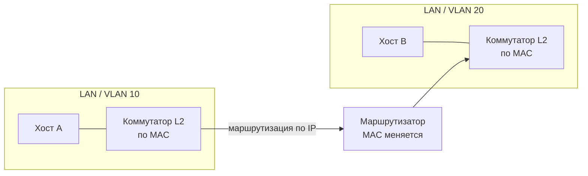

# Коммутация_Маршрутизация

> [!abstract] Кратко
> Коммутация — внутри LAN по MAC (L2), маршрутизация — между сетями по IP (L3). Коммутатор не пересекает границы подсети, маршрутизатор — именно это делает. Сравнение в одной таблице.

## 1. Зачем нужно
Развести два базовых механизма — без этого невозможно читать трассировки и понимать, где сеть «ломается».

## 2. Простыми словами
Коммутатор — внутри подъезда, маршрутизатор — между домами. Первый знает квартиры, второй — улицы.

## 3. Технические детали

| | Коммутация (L2) | Маршрутизация (L3) |
|---|---|---|
| Адрес | MAC | IP |
| Область | LAN, VLAN | Между сетями |
| Что меняется | Ничего (кроме TTL у хостов не влияет) | MAC на каждом хопе, TTL-1 |
| Broadcast | Летит по всей VLAN | Не пересекает границу сети |
| Таблица | MAC → порт | IP-сеть → следующий хоп |
| Устройство | Коммутатор | Маршрутизатор, L3-коммутатор |

- **Ключевое:** broadcast из VLAN не выйдет за маршрутизатор — это и есть граница сегментации.
- **L3-коммутатор:** «коммутатор с мозгами» — маршрутизация на скорости коммутации (см. [[Коммутатор_L3]]).

Схема:



- **Читать схему:** внутри VLAN — коммутация по MAC. Между VLAN — маршрутизация: пакет проходит маршрутизатор, MAC переписывается.

## 4. Пример / команда
Диагностика «где сломалось»:

```bash
ping <IP>          # есть ли путь вообще
tracert <IP>       # на каком хопе стоп — локальный L2 или маршрутизация
arp -a             # виден ли сосед по L2
```

## 5. Для ИБ

| Риск | Защита |
|------|--------|
| Broadcast-шторм в одной VLAN | Малые VLAN, storm control |
| Маршрутизация без ACL → изоляция фиктивна | ACL на L3-границах |
| L2-атаки на коммутаторе (MAC-flood) | Port Security |
| L3-атаки на маршрутизаторе | ACL, аутентификация протоколов |

## 6. Вопросы для самопроверки
1. По какому адресу работает коммутация?
2. По какому адресу работает маршрутизация?
3. Пересекает ли broadcast границу сети?
4. Что меняется при маршрутизации?
5. Что такое L3-коммутатор?

## Связи
- [[Коммутатор_L2]]
- [[Коммутатор_L3]]
- [[Маршрутизация]]
- [[Сеть_Подсеть]]
