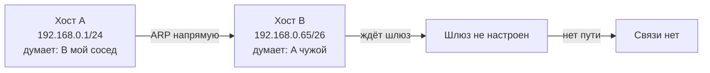

# Конфликт_Масок

> [!abstract] Кратко
> Разные маски в одной физической сети → устройства по-разному видят границы подсети. Часть трафика идёт напрямую, часть — через шлюз, часть теряется. Диагностика сложна.

## 1. Зачем нужно
Поймать тихую проблему: физически всё соединено, но «не пингуется». Причина — не кабель, а разные маски.

## 2. Простыми словами
Два человека на одной улице, но у одного карта города шире. Один идёт напрямую, другой ищет ворота. В итоге не встречаются.

## 3. Технические детали

Сценарий: в одной сети хосты с /24 и /26.

- Хост 192.168.0.1/24 считает 192.168.0.65 «своим» → шлёт ARP напрямую.
- Хост 192.168.0.65/26 считает 192.168.0.1 «чужим» → ждёт шлюз.
- Шлюза нет → связи нет.

Схема конфликта:



- **Читать схему:** A видит B как соседа, B видит A как чужого. Один шлёт напрямую, другой ждёт шлюз. Итог — потери.

| Проблема | Что происходит |
|---|---|
| Доступность | Узлы не видят друг друга |
| ARP | Лишние запросы на весь /24 |
| Маршрутизация | Часть ждёт шлюз, которого нет |
| Диагностика | «Кабель цел, а ping не идёт» |

- **Коммутатор L2 не спасает:** он смотрит MAC, а не IP/маску. Конфликт масок для него невидим.
- **Решение:** унифицировать маски или настроить маршрутизацию/VLAN.

## 4. Пример / команда
Проверка маски и ARP:

```bash
ipconfig /all      # Windows: маска на интерфейсе
arp -a             # есть ли запись соседа
ping 192.168.0.65  # идёт ли пакет
```

## 5. Для ИБ

| Риск | Защита |
|------|--------|
| Разные маски → скрытая потеря связи | Единый план адресации |
| ARP-шторм из-за широкой маски | Точные маски, VLAN |
| Диагностика «наугад» | Сначала маска, потом кабель |
| L2-коммутатор маскирует проблему | Проверять L3-настройки хостов |
| Нет документации по подсетям | Таблица подсетей и масок |

## 6. Вопросы для самопроверки
1. Почему разные маски ломают связь?
2. Видит ли L2-коммутатор конфликт масок?
3. Что делает хост /24 с адресом /26?
4. Как диагностировать конфликт?
5. Как исправить?

## Связи
- [[Маска_Подсети]]
- [[Сегментация_Сети]]
- [[Сеть_Подсеть]]
- [[Коммутатор_L2]]
- [[VLAN]]
