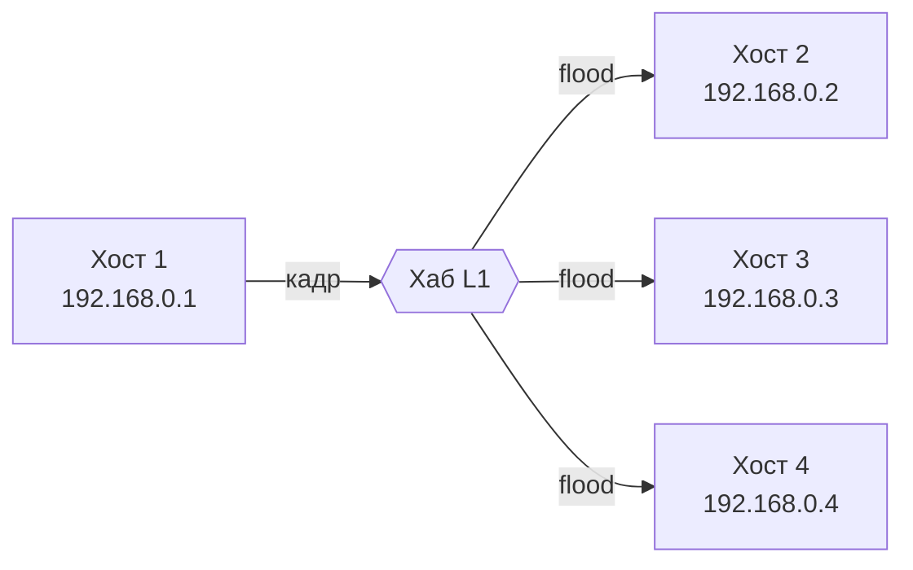

# Концентратор_Hub

> [!abstract] Кратко
> Хаб — устройство L1: передаёт кадр во все порты, кроме входного. Не различает адреса. Коллизии, общая пропускная способность. Заменён коммутаторами L2.

## 1. Зачем нужно
Понять, откуда взялись коммутаторы: хаб — базовая точка, от которой видно, зачем нужна MAC-таблица.

## 2. Простыми словами
Хаб — разветвитель-крикун: что услышал в один порт, кричит во все остальные. Коммутатор — разветвитель-адресный: отдаёт только тому, кому надо.

## 3. Технические детали
- **Уровень:** L1 (физический). Адреса не различает.
- **Поведение:** flood во все порты, кроме входного, всегда — даже при заполненных таблицах (таблиц нет).
- **Коллизии:** чем больше устройств, тем выше вероятность; один домен коллизий.
- **Пропускная способность:** делится между всеми портами.
- **Плюсы:** дёшево, просто, для маленьких сетей.
- **Минусы:** коллизии, низкая эффективность, нет изоляции.

Схема: хаб кричит во все порты.



- **Читать схему:** кадр от хоста 1 уходит всем, кроме порта-отправителя. Хост 3 и 4 получают чужой трафик.

## 4. Пример / команда
Проверить, что за устройство (косвенно — по поведению):

```bash
ping 192.168.0.2   # при хабе видны потери из-за коллизий
arp -a             # ARP-таблица заполняется у всех
```

## 5. Для ИБ

| Риск | Защита |
|------|--------|
| Flood во все порты → утечка кадра | Заменить на L2-коммутатор |
| Коллизии → отказ в обслуживании | Коммутатор, полный дуплекс |
| Нет изоляции → любой видит любой | VLAN, сегментация |
| Подслушивание трафика | Коммутатор + Port Security |
| Общая пропускная способность | Коммутатор, отдельные линки |

## 6. Вопросы для самопроверки
1. На каком уровне OSI работает хаб?
2. Куда хаб передаёт кадр?
3. Почему возникают коллизии?
4. Чем хаб отличается от L2-коммутатора?
5. Почему хаб небезопасен?

## Связи
- [[Коммутатор_L2]]
- [[ARP_в_локальной_сети]]
- [[Коммутация_Маршрутизация]]
- [[Сегментация_Сети]]