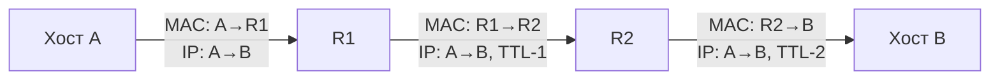

# Маршрутизация

> [!abstract] Кратко
> Маршрутизация — передача пакета между сетями через L3-устройство. При маршрутизации MAC-адреса переписываются на каждом хопе, IP — нет (без NAT). TTL уменьшается на каждом хопе. Решение о маршруте — по таблице маршрутизации (самая длинная маска побеждает).

## 1. Зачем нужно
Понять, что именно меняется в пакете на пути от отправителя к получателю. Без этого нельзя диагностировать «где сломалось»: коммутация или маршрутизация.

## 2. Простыми словами
Пакет — письмо, MAC — конверт, IP — адрес получателя. На каждом пересадочном пункте конверт переписывают (MAC), а адрес получателя остаётся тем же (IP). TTL — счётчик пересадок: обнулится — письмо уничтожат.

## 3. Технические детали

**Что меняется на каждом хопе:**

| Поле | Меняется? |
|---|---|
| MAC источника/назначения | Да, на каждом хопе |
| IP источника/назначения | Нет (без NAT) |
| TTL | Да, минус 1 на каждом хопе |

**Таблица маршрутизации:**
- Записи: сеть назначения / маска → следующий хоп.
- При совпадении нескольких маршрутов побеждает **самая длинная маска** (наиболее конкретный префикс).
- При отсутствии маршрута — пакет отбрасывается или уходит в default route.

**Маршрутизация vs коммутация:**
- Коммутатор L2: решает по MAC внутри LAN.
- Маршрутизатор: решает по IP между сетями, переписывает MAC.

Схема: путь пакета A → R1 → R2 → B.



- **Читать схему:** MAC переписывается на каждом хопе (конверт), IP неизменен (адрес), TTL убывает.

## 4. Пример / команда
Просмотр таблицы маршрутизации:

```bash
ip route show       # Linux
route print         # Windows
show ip route       # Cisco
```

## 5. Для ИБ

| Риск | Защита |
|------|--------|
| Лишние маршруты → обход сегментации | Ревизия таблиц, только нужные маршруты |
| Default route везде → все| Default route везде → весь трафик через одну точку: единая точка отказа и контроля | Осознанный дизайн: default только на границе, ревизия таблиц |
| Злоумышленник добавил маршрут → трафик уведён через себя | Аутентификация протоколов маршрутизации (OSPF md5), контроль изменений таблиц |

## 6. Вопросы для самопроверки
1. Что меняется в пакете на маршрутизаторе, а что нет?
2. Почему MAC переписывается на каждом хопе, а IP — только при NAT?
3. Что произойдёт с пакетом, когда TTL обнулится?
4. Два маршрута к одной сети: /24 и /16. Какой выберет маршрутизатор?
5. Чем решение маршрутизатора отличается от решения коммутатора L2?

## Связи
- [[Модель_OSI]] — место маршрутизации на L3
- [[Коммутация_Маршрутизация]] — сравнение двух механизмов передачи
- [[Шлюз_по_умолчанию]] — частный случай маршрута
- [[Маска_Подсети]] — маска как основа решения «самая длинная маска»
- [[Приоритет_маршрутов]] — правила выбора при нескольких маршрутах
- [[Статическая_Маршрутизация]] — маршруты вручную
- [[Динамическая_Маршрутизация]] — маршруты от протоколов
- [[Межвлановая_Маршрутизация]] — маршрутизация между VLAN

