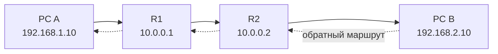

# Маршрутизация_между_двумя_маршрутизаторами

> [!abstract] Кратко
> Стенд из двух роутеров и двух LAN. Пакет идёт только в одну сторону, пока не настроить маршрут обратно. Главная ловушка новичка: ответ не находит пути назад — выглядит как «сеть не работает».

## 1. Зачем нужно
Понять основы статики на минимальном стенде и увидеть самую частую ошибку: забыт обратный маршрут.

## 2. Простыми словами
Путь туда и путь обратно — два разных маршрута. Настроил один — посылка уехала, но ответ вернуться не может.

## 3. Технические детали

**Стенд:**

| Сегмент | Сеть | Сторона |
|---|---|---|
| LAN 1 | `192.168.1.0/24` | R1 |
| LAN 2 | `192.168.2.0/24` | R2 |
| Link | `10.0.0.0/30` | R1 ↔ R2 |

**Настройка:**

```bash
# R1
ip route 192.168.2.0 255.255.255.0 10.0.0.2
# R2
ip route 192.168.1.0 255.255.255.0 10.0.0.1
```

**Ловушка:** без маршрута на R2 пакет от B к A отбрасывается — ping с A выглядит как «R2 мёртв», хотя проблема на обратном пути.

Схема:



- **Читать схему:** путь есть в обе стороны. Убери маршрут на R2 — обратный пакет не вернётся.

## 4. Пример / команда
Диагностика обратного маршрута:

```bash
ping 192.168.2.10       # с A — таймауты
tracert 192.168.2.10    # видно, где обрывается
show ip route 192.168.1.0   # на R2 — есть ли маршрут обратно
```

## 5. Для ИБ

| Риск | Защита |
|------|--------|
| Асимметричная маршрутизация → stateful firewall видит «левые» пакеты | Симметричные маршруты, проверка |
| Маршруты без авторизации в конфиге | Ревизия конфигов, baseline |
| Обратный маршрут в ненужную сеть → утечка | Фильтрация, только нужные маршруты |
| Диагностика «по интуиции» → потеря времени | Сначала `show ip route`, потом гипотезы |

## 6. Вопросы для самопроверки
1. Почему нужен маршрут в обе стороны?
2. Что происходит без обратного маршрута?
3. Что такое /30 на линке?
4. Как диагностировать проблему обратного маршрута?
5. Чем асимметрия мешает stateful-фильтрации?

## Связи
- [[Маршрутизация]]
- [[Статическая_Маршрутизация]]
- [[Приоритет_маршрутов]]
