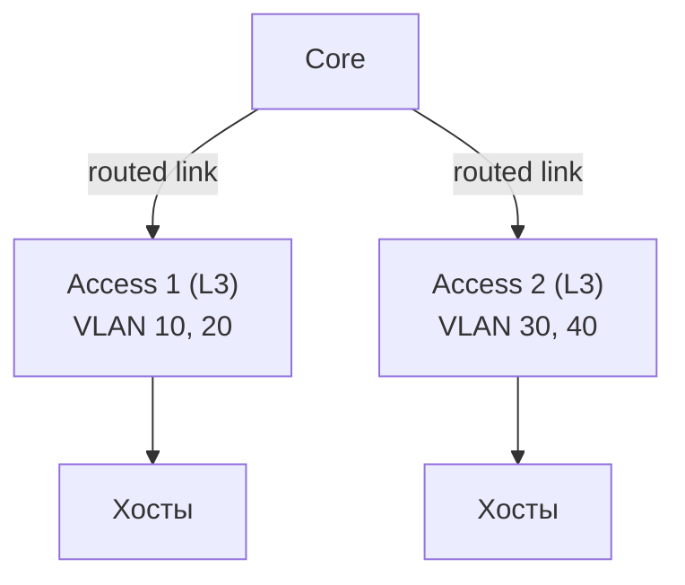

# Маршрутизация_на_Access

> [!abstract] Кратко
> Альтернатива классике: маршрутизация «спускается» на Access-коммутаторы L3. Каждый access-коммутатор маршрутизирует свои VLAN, вверх — один routed-link. Больше маршрутов в ядре, но меньше L2-домены (и STP).

## 1. Зачем нужно
Понять вторую архитектуру: когда access-коммутаторы тоже L3 и маршрутизируют сами. Это ответ на главную боль классической модели — большой L2-домен со STP.

## 2. Простыми словами
В классике один узел решает за всех. Здесь у каждого этажа свой узел пересадок: быстрее локально, но глобальная карта становится сложнее.

## 3. Технические детали

| | Классика (Dist) | Маршрутизация на Access |
|---|---|---|
| L2-домены | Большие, через Distribution | Малые, в пределах access-стека |
| STP | Глубокий, риск блокировок | Минимален или не нужен |
| Маршрутов вверх | Summary | По одному на каждый сегмент |
| Требования к Access | Дешёвый L2 | L3-коммутаторы, дороже |
| Отказ Distribution | Влияет на всех | Локально |

- **Когда выбирать:** современная архитектура, «routed access». Снижает риск broadcast-шторма и уязвимостей STP.
- **Цена:** больше записей маршрутов в ядре, L3-лицензии на access-коммутаторах.

Схема:



- **Читать схему:** между Core и Access — routed links, не trunk. L2 заканчивается на access-коммутаторе.

## 4. Пример / команда
Routed access:

```bash
ip routing
interface GigabitEthernet0/1
 no switchport
 ip address 10.255.0.1 255.255.255.254
```

## 5. Для ИБ

| Риск | Защита |
|------|--------|
| Больше узлов маршрутизации → больше точек атаки | Стандартная hardening-конфигурация на каждом |
| Разная политика на разных access | Шаблоны конфигурации, автозадеплой |
| Сложный контроль межсегментного трафика | ACL на каждом access, централизованный аудит |
| L3-функции на дешёвом железе | Минимальные требования к железу в закупке |

## 6. Вопросы для самопроверки
1. Чем routed access отличается от классики?
2. Почему исчезает глубокий STP?
3. Что между Core и Access в routed access?
4. Главный минус?
5. Когда выбирать routed access?

## Связи
- [[Маршрутизация_на_Distribution]]
- [[Выбор_архитектуры_маршрутизации]]
- [[Трехуровневая_модель_сети]]
- [[Коммутатор_L3]]
