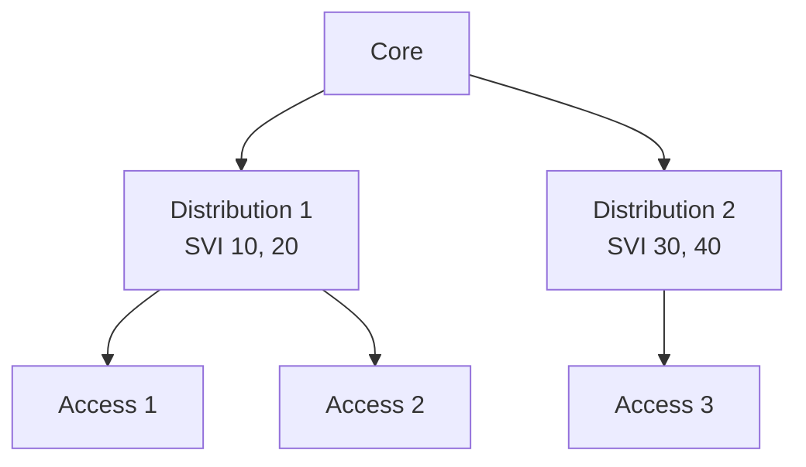

# Маршрутизация_на_Distribution

> [!abstract] Кратко
> В трехуровневой модели маршрутизация ставится на Distribution-уровне: коммутаторы L3 связывают access-сегменты, интер-VLAN-маршрутизация локализуется, вверх идут summary-маршруты. Access — только L2.

## 1. Зачем нужно
Понять, где в типовой корпоративной сети живут маршруты и почему access-коммутатор их не считает.

## 2. Простыми словами
Access — проходные дворы, там только переключение. Distribution — узел пересадок, там и решают, куда какой пакет. Core — междугородный вокзал, только пересылка между городами.

## 3. Технические детали

**Классическое разделение:**

| Уровень | Что делает |
|---|---|
| Access | Только L2: порты VLAN, STP. Маршрутизации нет |
| Distribution | L3: SVI для VLAN, inter-VLAN-маршрутизация, summary вверх |
| Core | Транзит между Distribution, минимум функций |

- **Inter-VLAN на Distribution:** SVI на каждой VLAN access-уровня.
- **Summary вверх:** Distribution объявляет агрегированные префиксы (например, `10.1.0.0/16`), Core не перегружается деталями.
- **Преимущества:** маршрутизация локализована, отказы не всплывают в Core, проще фильтровать на Distribution.

Схема:



- **Читать схему:** маршрутизация — на Distribution. Access только «раздает» VLAN, Core только транзит.

## 4. Пример / команда
SVI и summary на Distribution:

```bash
interface vlan 10
 ip address 10.1.10.1 255.255.255.0
router ospf 1
 area 1 range 10.1.0.0 255.255.0.0
```

## 5. Для ИБ

| Риск | Защита |
|------|--------|
| Access-коммутатор получил маршрутизацию → обход политик | Чёткое назначение уровней, конфигурация по роли |
| Межвлановый трафик без ACL на Distribution | ACL на SVI (см. [[Межвлановая_Маршрутизация]]) |
| Core видит детали всех сегментов | Summary, isolation |
| Нет контроля на границе Distribution → Core | Фильтрация на Distribution |

## 6. Вопросы для самопроверки
1. Где в модели ставится маршрутизация?
2. Что делает Access?
3. Что такое summary вверх?
4. Почему маршрутизация не на Access?
5. Где фильтровать межвлановый трафик?

## Связи
- [[Трехуровневая_модель_сети]]
- [[Межвлановая_Маршрутизация]]
- [[Маршрутизация_на_Access]]
- [[Выбор_архитектуры_маршрутизации]]
