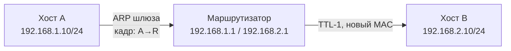

# Маршрутизация_через_Маршрутизатор

> [!abstract] Кратко
> Базовый сценарий: пакет из одной подсети в другую через маршрутизатор-шлюз. Шаги: хост решает «свой/чужой» → ARP шлюза → кадр шлюзу → маршрутизатор смотрит таблицу → TTL-1, новый MAC → доставка в следующую сеть.

## 1. Зачем нужно
Понять путь пакета между двумя подсетями на уровне механики. Это фундамент для всей маршрутизационной серии: без этой картинки не читаются ни конфликт масок, ни Router-on-a-Stick, ни диагностика ping.

## 2. Простыми словами
Сосед через дорогу — не в твоём подъезде, напрямую не позвонишь. Ты передаёшь письмо консьержу (шлюзу), а он уже знает, в какой подъезд нести. Твой конверт (MAC) он заменит на свой — но адрес на письме (IP) не тронет.

## 3. Технические детали

**Шаги:**

1. Хост A сравнивает свой IP и IP получателя по маске: **свой** → ARP напрямую, **чужой** → пункт 2.
2. Хост A находит **шлюз по умолчанию** (маршрутизатор в своей подсети).
3. Хост A ARP-запросом узнаёт MAC шлюза и отправляет кадр шлюзу (IP-адрес в пакете — по-прежнему получателя).
4. Маршрутизатор получает кадр, проверяет таблицу маршрутизации, выбирает интерфейс к следующей сети.
5. На исходящем интерфейсе: TTL − 1, MAC-адреса переписаны (источник — MAC роутера, получатель — MAC следующего хопа или хоста B).
6. Пакет доставляется в сеть B — там ARP может понадобиться ещё раз.

**Ключевые правила:**
- IP-адрес отправителя и получателя **не меняются** (без NAT).
- MAC меняется на каждом хопе.
- Если маршрута нет — пакет отбрасывается, маршрутизатор шлёт ICMP Destination Unreachable.
- Если TTL кончился — ICMP Time Exceeded (на этом стоит traceroute).

Схема:



- **Читать схему:** A отправляет кадр не B, а шлюзу. Шлюз переписывает MAC и передаёт в сеть B.

## 4. Пример / команда
Проследить путь пакета:

```bash
ip route show        # есть ли default gateway
arp -a               # MAC шлюза известен?
ping 192.168.2.10    # пингуется ли через шлюз
traceroute 192.168.2.10   # где первый хоп — шлюз
```

## 5. Для ИБ

| Риск | Защита |
|------|--------|
| ARP-спуфинг шлюза → MITM между подсетями | DAI, статические ARP-записи шлюза |
| Шлюз без ACL → свободная передача между сегментами | ACL на интерфейсах маршрутизатора |
| ICMP отбрасывается → диагностика вслепую | Разрешить TTL-exceeded/Unreachable внутри сети |
| Подмена шлюза в DHCP → трафик через атакующего | DHCP Snooping |

## 6. Вопросы для самопроверки
1. По какому MAC хост шлёт пакет в чужую подсеть?
2. Что меняется в пакете при проходе через маршрутизатор?
3. Что шлёт маршрутизатор при отсутствии маршрута?
4. Что шлёт при обнулении TTL?
5. Как traceroute использует TTL?

## Связи
- [[Маршрутизация]]
- [[Шлюз_по_умолчанию]]
- [[ARP_в_локальной_сети]]
- [[Протокол_ARP]]
- [[Межвлановая_Маршрутизация]]
- [[Конфликт_Масок]]
