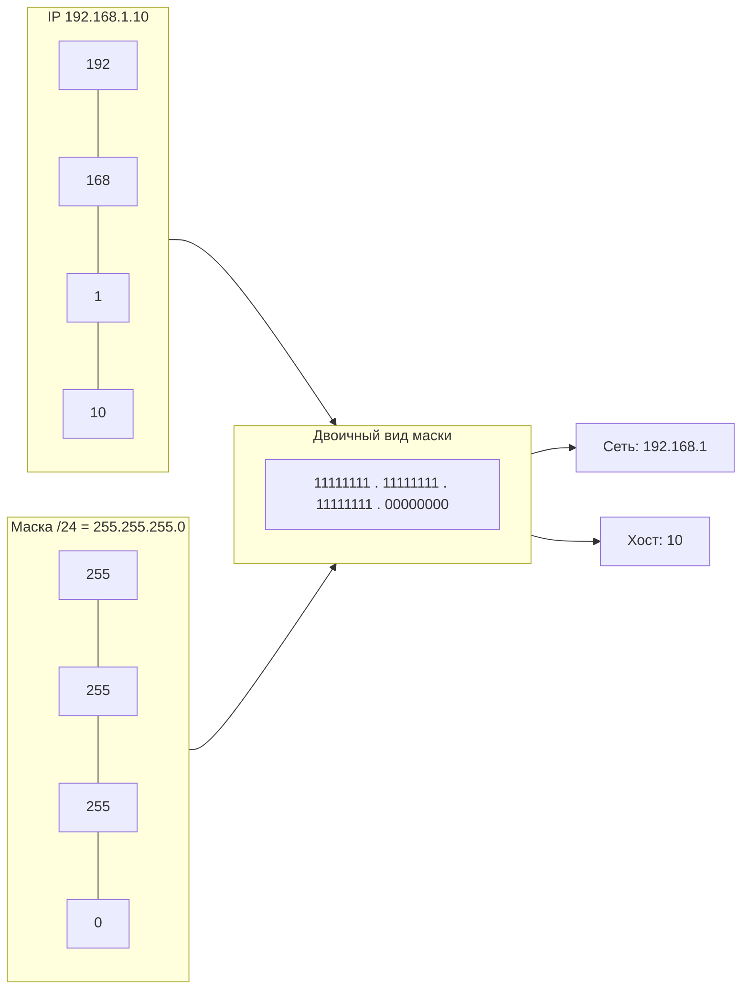

# Маска_Подсети

> [!abstract] Кратко
> Маска — набор единиц и нулей: единицы фиксируют адрес сети, нули — адрес хоста. Префикс /N — число единиц. Формула хостов: 2^n − 2.

## 1. Зачем нужно
Понять, где в IP кончается сеть и начинается хост. Без маски IP — просто четыре числа.

## 2. Простыми словами
IP — это адрес дома. Маска — линейка, которая говорит: «первые N цифр — улица, остальные — номер дома». Улица общая, номер уникальный.

## 3. Технические детали

- **Маска:** слева единицы подряд, справа нули. Пример: 11111111.11111111.11111111.00000000 = 255.255.255.0 = /24.
- **Префикс /N:** число единиц. /24 = 24 единицы, 8 нулей.
- **Граница:** единицы — сеть (не меняется), нули — хост (уникален).
- **Формула:** 2^n − 2, где n — биты хоста. Минус адрес сети и broadcast.
- **Пример /26:** 6 бит хоста → 64 адреса → 62 хоста.

Схема битов для 192.168.1.10/24:



- **Читать схему:** три октета единиц → сеть 192.168.1. Последний октет нулей → хост 10. Граница — между третьим и четвёртым октетом.

## 4. Пример / команда
Расчёт подсети:

```bash
# Linux: показать адрес и маску
ip -c addr show
# Windows
ipconfig
```

## 5. Для ИБ

| Риск | Защита |
|------|--------|
| Маска шире нужного → лишние хосты в сегменте | Точный префикс, ревизия подсетей |
| /31 или /32 в LAN → нет адресов хостов | Не использовать в LAN |
| Ошибка в маске → хост не видит шлюз | Проверка ipconfig/ip addr |
| Одинаковые подсети на разных линках | План адресации, документирование |

## 6. Вопросы для самопроверки
1. Что означает /24?
2. Где в маске кончается сеть и начинается хост?
3. Формула числа хостов?
4. Сколько хостов в /26?
5. Почему вычитают 2?

## Связи
- [[Сеть_Подсеть]]
- [[Сегментация_Сети]]
