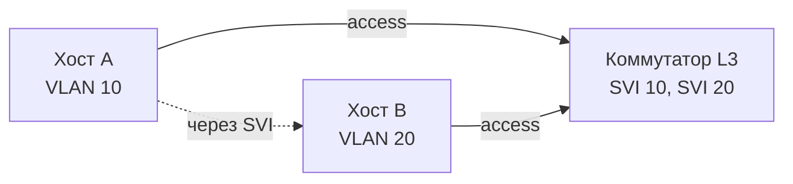

# Межвлановая_Маршрутизация

> [!abstract] Кратко
> VLAN изолируют L2. Связь между VLAN — только через L3. Три способа: отдельный маршрутизатор с одним интерфейсом на VLAN, Router-on-a-Stick (один интерфейс, сабинтерфейсы 802.1Q), SVI на коммутаторе L3. Выбор — по нагрузке и бюджету.

## 1. Зачем нужно
Понять, как устройства из разных VLAN общаются — и где в этот момент проходит граница контроля трафика.

## 2. Простыми словами
VLAN — это разные комнаты. Из комнаты в комнату — через коридор (L3). Кто строит коридор и ставит пропускной пункт — тот и решает, кого пускать.

## 3. Технические детали

| Способ | Как работает | Плюсы | Минусы |
|---|---|---|---|
| **Отдельный маршрутизатор** | По одному физическому интерфейсу на VLAN | Просто, «железный» L3 | Дорого: кабели и порты на каждую VLAN |
| **Router-on-a-Stick** | Один интерфейс, сабинтерфейсы с тегами 802.1Q через trunk | Дёшево, минимум кабелей | Один линк — узкое место (bottleneck) |
| **SVI на L3-коммутаторе** | Виртуальный интерфейс на каждую VLAN прямо в коммутаторе | Быстро (hardware), без отдельного маршрутизатора | Дорогой коммутатор L3 |

- **Схема пути пакета:** хост A (VLAN 10) → шлюз (SVI/сабинтерфейс) → решение по маршрутизации → VLAN 20 → хост B.
- **MAC и IP:** при межвлановой маршрутизации MAC меняется на каждом хопе, IP не меняется (без NAT). См. [[Маршрутизация]].

Схема:



- **Читать схему:** SVI в коммутаторе заменяет внешний маршрутизатор. Пакет из VLAN 10 в VLAN 20 проходит через коммутатор один раз.

## 4. Пример / команда
SVI на Cisco:

```bash
interface vlan 10
 ip address 192.168.10.1 255.255.255.0
interface vlan 20
 ip address 192.168.20.1 255.255.255.0
ip routing
```

## 5. Для ИБ

| Риск | Защита |
|------|--------|
| Межвлановый трафик без фильтрации → боковое перемещение | ACL на SVI, firewall на L3 |
| Открыты «все маршруты» между VLAN | Явный список разрешённых связей (default deny) |
| Management VLAN доступен из пользовательских | ACL: только с адресов администраторов |
| Гостевая VLAN видит LAN | Гостевая — только в интернет, изоляция |
| Один trunk → узкое место и DDoS-мишень | Резервирование, контроль полосы |

## 6. Вопросы для самопроверки
1. Почему VLAN не общаются на L2?
2. Три способа межвлановой маршрутизации?
3. Что такое Router-on-a-Stick?
4. Что такое SVI?
5. Что меняется в кадре при переходе между VLAN?
6. Где ставить фильтрацию трафика между VLAN?

## Связи
- [[VLAN]]
- [[Router_on_a_Stick]]
- [[SVI]]
- [[Коммутатор_L3]]
- [[Маршрутизация]]
- [[Super_VLAN]]
