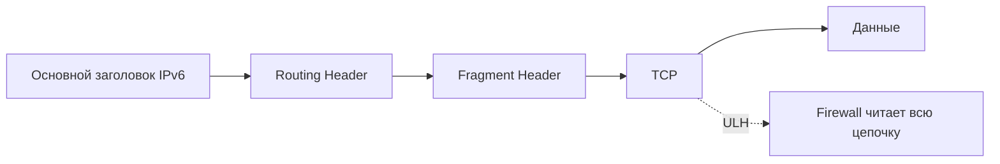

# Отличия_IPv4_IPv6

> [!abstract] Кратко
> 8 ключевых отличий: упрощённый заголовок, масштабируемость, маршрутизация (цепочка расширенных заголовков), встроенный IPsec, SLAAC, multicast/anycast, Flow Label для QoS, фрагментация только отправителем.

## 1. Зачем нужно
Понять, чем IPv6 лучше IPv4 и где он сложнее. Без этого переход кажется «просто длиннее адрес».

## 2. Простыми словами
IPv6 — не «IPv4 с длинным адресом», а переработанный протокол: проще заголовок, но сложнее цепочка расширений.

## 3. Технические детали

| # | Отличие | Суть |
|---|---|---|
| 1 | **Заголовок** | Убраны длина заголовка, ID, флаги, смещение фрагмента, контрольная сумма, опции. Добавлено поле Flow Label |
| 2 | **Масштабируемость** | 128 бит вместо 32, P2P без NAT |
| 3 | **Маршрутизация** | Нет контрольной суммы → быстрее; но протокол L4 определяется цепочкой расширенных заголовков (ULH) |
| 4 | **Безопасность** | IPsec встроен в стандарт (в IPv4 — опционален) |
| 5 | **Автонастройка** | SLAAC — адрес без DHCP |
| 6 | **Multicast/Anycast** | Broadcast заменён targeted multicast; anycast — один адрес на несколько устройств |
| 7 | **QoS** | Flow Label (20 бит) вместо анализа DSCP+портов |
| 8 | **Фрагментация** | Только отправителем, маршрутизаторы не фрагментируют |

**Проблема с firewall в IPv6:**

- IPv4: поле `Protocol` напрямую указывает TCP/UDP/ICMP.
- IPv6: поле `Next Header` указывает следующий заголовок в цепочке. Firewall читает всю цепочку до ULH (Upper Layer Header).
- Цепочка: Основной заголовок → Routing → Fragment → TCP → Данные.

Схема:



- **Читать схему:** чтобы найти TCP, firewall проходит все расширенные заголовки. Это дороже, чем в IPv4.

## 4. Пример / команда
Проверка цепочки:

```bash
tcpdump -i eth0 -vv 'ip6'
```

## 5. Для ИБ

| Риск | Защита |
|------|--------|
| RH0 (Routing Header Type 0) → DoS-петли | Исключён IETF в 2007, блокировать на firewall |
| Firewall не читает цепочку → пропуск | Явные правила для расширенных заголовков |
| IPsec «встроен» → ложное чувство защиты | Проверка конфигурации IPsec |
| Фрагментация только отправителем → ICMP-зависимость | Не блокировать ICMPv6 полностью |

## 6. Вопросы для самопроверки
1. Что убрали из заголовка IPv6?
2. Что добавили?
3. Как IPv6 определяет протокол L4?
4. Почему firewall сложнее в IPv6?
5. Кто фрагментирует в IPv6?

## Связи
- [[IPv6]]
- [[SLAAC_DHCPv6]]
- [[Multicast_Anycast]]
- [[Проблемы_перехода_IPv6]]
