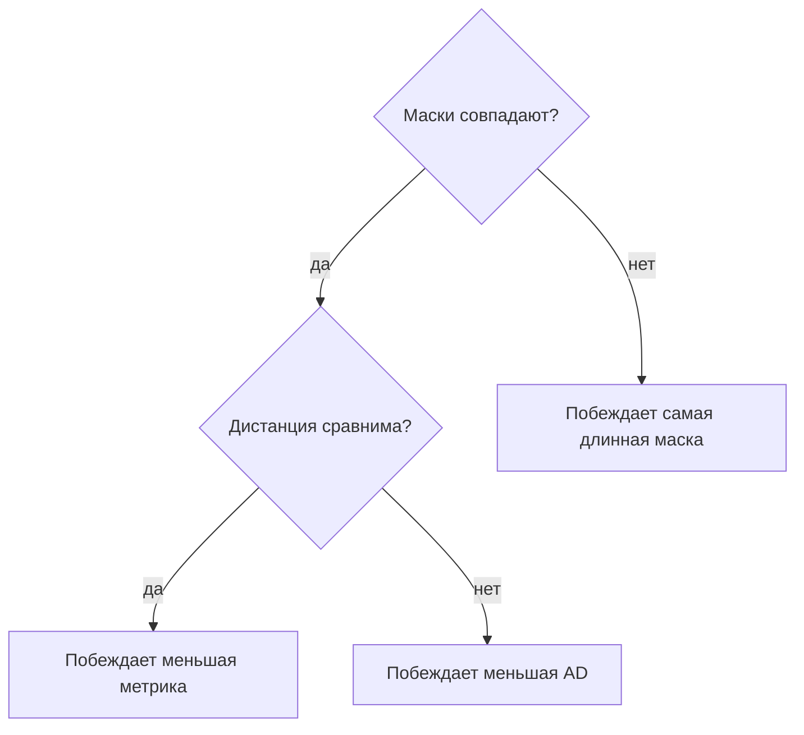

# Приоритет_маршрутов

> [!abstract] Кратко
> Если к одной сети есть несколько маршрутов, выбирается по иерархии: сначала самая длинная маска, потом административная дистанция, потом метрика.

## 1. Зачем нужно
Понять, какой из двух «дорог к одному адресу» выберет маршрутизатор — и почему статический маршрут может «победить» OSPF.

## 2. Простыми словами
Три фильтра подряд: сначала точность адреса (маска), потом источник знания (дистанция), потом качество дороги (метрика). Побеждает тот, кто проходит все фильтры лучше остальных.

## 3. Технические детали

**Порядок выбора (если несколько маршрутов к одной сети):**

1. **Маска (префикс):** самая длинная маска выигрывает. /24 → /30: /30 более конкретный.
2. **Административная дистанция (AD):** доверию к источнику.

| Источник | AD (Cisco) |
|---|---|
| Connected | 0 |
| Static | 1 |
| OSPF | 110 |
| RIP | 120 |

3. **Метрика:** «качество» пути внутри одного протокола (хопы для RIP, стоимость для OSPF).

**Пример:** к `10.0.0.0/24` есть static (`AD 1`) и OSPF (`AD 110`) → идёт static, хоть OSPF и «умнее». Чтобы OSPF выиграл, static ставят с плавающей меткой (`ip route ... 200`) — активируется только при отказе основного.

Схема:



- **Читать схему:** три фильтра последовательно: маска → дистанция → метрика.

## 4. Пример / команда
Просмотр приоритетов:

```bash
show ip route
# маршруты одной сети с разными [AD/metric]
```

## 5. Для ИБ

| Риск | Защита |
|------|--------|
| Впрыск ложного маршрута с меньшей AD | Аутентификация протоколов, защита консоли |
| Статический «чужой» маршрут → обход фильтра | Ревизия конфигураций, baseline |
| Floating static сработал неожиданно | Тестировать отказы в лабе |
| Метрика «поломана» → маршрут через опасный путь | Мониторинг таблиц, NetFlow |

## 6. Вопросы для самопроверки
1. Порядок выбора маршрута?
2. Что такое административная дистанция?
3. Чья дистанция у connected?
4. Зачем floating static?
5. Что такое метрика?

## Связи
- [[Маршрутизация]]
- [[Динамическая_Маршрутизация]]
- [[Статическая_Маршрутизация]]
