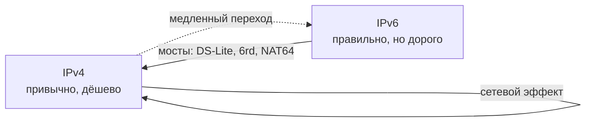

# Проблемы_перехода_IPv6

> [!abstract] Кратко
> IPv6 существует ~20 лет, но IPv4 не ушёл. Шесть причин: сетевой эффект, NAT, сложность миграции, инфраструктура, технологии-«мосты», подготовка персонала. В России ~28% IPv6.

## 1. Зачем нужно
Понять, почему IPv6 не заменил IPv4, хотя должен был. Без этого переход кажется «просто вопросом времени».

## 2. Простыми словами
Новая дорога построена, но старая привычнее, дешевле и уже оплачена. Все ждут, пока сосед переедет первым.

## 3. Технические детали

**Шесть причин:**

| # | Причина | Суть |
|---|---|---|
| 1 | **Сетевой эффект** | Ценность зависит от числа пользователей. Facebook перешёл в 2012, но вернул IPv4-зеркала |
| 2 | **NAT** | Реальная альтернатива. Без NAT IPv4 закончился бы в 2010. Каскадирование NAT → ограничения |
| 3 | **Сложность миграции** | Двойные стеки → нагрузка и стоимость. Уязвимость RH0 в IPv6 |
| 4 | **Инфраструктура** | Провайдерам — замена оборудования; корпорациям — legacy; пользователям — дешёвые роутеры без IPv6 |
| 5 | **Технологии-«мосты»** | DS-Lite (туннель к NAT), 6rd (IPv6 поверх IPv4), NAT64+DNS64 («костыль на костыле») |
| 6 | **Подготовка персонала** | Мало опыта, IPv6 считают «экспериментальным», политики слабее |

- **По данным Google:** ~45% трафика IPv6 в мире, в России ~28%.
- **Где IPv6 в России:** ЦОДы и крупные операторы. Малый/средний бизнес — на IPv4.

Схема:



- **Читать схему:** IPv4 держится за счёт привычки и мостов. IPv6 растёт, но медленно.

## 4. Пример / команда
Проверка IPv6 на своём устройстве:

```bash
ip -6 addr show
curl -6 https://ifconfig.co
```

## 5. Для ИБ

| Риск | Защита |
|------|--------|
| IPv6 включён, но не защищён → обход IPv4-правил | Явные правила firewall для IPv6 |
| Туннели 6rd/DS-Lite → скрытый трафик | Аудит туннелей, отключение лишнего |
| NAT64/DNS64 → сложная диагностика | Документация, мониторинг |
| «Экспериментальный» IPv6 → слабые политики | Приравнять IPv6 к IPv4 по политикам |

## 6. Вопросы для самопроверки
1. Сколько трафика IPv6 в мире?
2. Сколько в России?
3. Что такое сетевой эффект?
4. Зачем NAT задержал переход?
5. Что такое NAT64?

## Связи
- [[IPv6]]
- [[Отличия_IPv4_IPv6]]
- [[SLAAC_DHCPv6]]
- [[Multicast_Anycast]]
