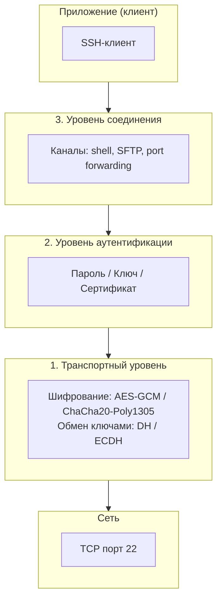

# Протокол_SSH

> [!abstract] Кратко
> SSH (Secure Shell) — криптографический протокол прикладного уровня (RFC 4251–4254, порт TCP 22) для безопасного удалённого входа, выполнения команд, передачи файлов и туннелирования через недоверенную сеть. Заменил Telnet и rlogin, объединив аутентификацию хоста, аутентификацию пользователя и шифрованный канал. Архитектура — клиент-сервер, три уровня: транспорт, аутентификация, соединение.

## 1. Зачем нужно
Понять, как безопасно управлять удалённым сервером, не отправляя пароли и команды открытым текстом. SSH — базовый инструмент администрирования Linux/Unix и сетевого оборудования.

## 2. Простыми словами
SSH — это «бронированная труба» от твоего компьютера до сервера. Внутри трубы ты можешь вводить команды, передавать файлы, пробрасывать порты. Снаружи никто не видит, что внутри. Это замена «открытой телефонной линии» (Telnet), где любой мог подслушать пароль.

## 3. Технические детали

### 3.1. История и версии
| Версия | Год | Особенности |
|---|---|---|
| **SSH-1** | 1995, Tatu Ylönen | Асимметричное шифрование RSA, уязвимости, устарел |
| **SSH-2** | 1996+ | Более стойкий, поддерживает RSA и DSA, несовместим с SSH-1 |
| **OpenSSH** | 1999+ | Свободная реализация, стандарт де-факто. Поддержка SSH-1 удалена с версии 7.6 |

### 3.2. Архитектура (три уровня)
SSH работает по классической модели **клиент-сервер**. Сервер слушает TCP-порт 22. Протокол разделён на три уровня, каждый над предыдущим:

| Уровень | Что делает |
|---|---|
| **1. Транспортный** | Устанавливает TCP-соединение, обменивается версиями, согласует алгоритмы (шифрование, обмен ключами, хеш), выполняет обмен ключами (Diffie-Hellman / ECDH), создаёт шифрованный канал |
| **2. Аутентификация пользователя** | Проверяет подлинность клиента: по паролю, по ключу, по сертификату |
| **3. Соединение** | Мультиплексирует несколько логических каналов (сессия shell, SFTP, проброс портов) внутри одного SSH-соединения |

![[Pasted image 20261113083259.png]]
Схема: три уровня SSH.



- **Читать схему:** клиент проходит три уровня: сначала создаётся шифрованный туннель, затем проверяется пользователь, затем открываются каналы для команд и файлов.

### 3.3. Аутентификация
| Метод | Как работает | Безопасность |
|---|---|---|
| **По паролю** | Пароль передаётся внутри шифрованного канала | Средняя: уязвим к перебору, если пароль слабый |
| **По ключу (публичный/приватный)** | Клиент доказывает владение приватным ключом, не передавая его | Высокая: предпочтительна для автоматизации и администрирования |
| **По сертификату** | Используется X.509 или собственный CA | Высокая: удобно для больших инфраструктур |
| **По хосту (IP)** | Сервер помнит IP клиента | Низкая: IP легко подменить |

**Ключевой механизм (по ключу):**
1. Клиент отправляет серверу свой публичный ключ.
2. Сервер проверяет, есть ли этот ключ в `~/.ssh/authorized_keys`.
3. Если есть — отправляет клиенту «вызов» (случайные данные).
4. Клиент подписывает вызов **приватным** ключом и отправляет подпись обратно.
5. Сервер проверяет подпись публичным ключом. Если верно — доступ разрешён.

Приватный ключ **никогда** не покидает клиентскую машину.

### 3.4. Туннелирование (Port Forwarding)
SSH умеет пробрасывать порты, создавая шифрованные туннели для других протоколов:

| Тип | Команда | Что делает |
|---|---|---|
| **Локальный (-L)** | `ssh -L 8080:internal:80 user@server` | Пробрасывает локальный порт 8080 на `internal:80` через сервер |
| **Удалённый (-R)** | `ssh -R 9090:localhost:3000 user@server` | Открывает порт 9090 на сервере, перенаправляя на локальный 3000 |
| **Динамический (-D)** | `ssh -D 1080 user@server` | Создаёт SOCKS-прокси на локальном порту 1080 |

Это позволяет обходить сетевые ограничения и безопасно подключаться к внутренним ресурсам.

### 3.5. Безопасность
- **Шифрование:** весь трафик (аутентификация, команды, данные) шифруется симметричным алгоритмом (AES-GCM, ChaCha20-Poly1305).
- **Целостность:** хеширование (SHA-2) обнаруживает модификацию данных в пути.
- **Аутентификация хоста:** клиент проверяет ключ сервера через `known_hosts`, что предотвращает MITM.

## 4. Пример / команда
Базовое подключение:
```bash
ssh user@192.168.1.10
```

Подключение с ключом:
```bash
ssh -i ~/.ssh/id_ed25519 user@server
```

Генерация ключевой пары (Ed25519):
```bash
ssh-keygen -t ed25519 -C "comment"
```

Копирование публичного ключа на сервер:
```bash
ssh-copy-id user@server
```

Проверка поддерживаемых алгоритмов:
```bash
ssh -Q cipher      # симметричные шифры
ssh -Q kex         # обмен ключами
ssh -Q key         # типы ключей
```

## 5. Для ИБ

| Риск | Защита |
|------|--------|
| Брутфорс пароля SSH | Отключить пароли, использовать ключи; Fail2ban, rate limiting |
| Утечка приватного ключа | Хранить в защищённом месте, использовать парольную фразу на ключе |
| SSH-туннели в обход firewall | Инспекция SSH на NGFW (UserGate), блокировка туннелей |
| Подмена сервера (MITM) | Проверка `known_hosts`, использование строгих алгоритмов |
| Уязвимости в OpenSSH | Регулярные обновления, мониторинг CVE |
| Скомпрометированные ключи в `authorized_keys` | Аудит `authorized_keys`, удаление неизвестных ключей |

**Инспекция SSH в UserGate NGFW:** администратор может включить SSH-прокси на зоне и создать правила инспектирования SSH для расшифровки трафика, блокировки удалённого запуска shell, выполнения команд или SFTP. Это позволяет контролировать туннели и предотвращать их использование для обхода сегментации.

## 6. Вопросы для самопроверки
1. На каком порту работает SSH по умолчанию?
2. Чем SSH-2 отличается от SSH-1?
3. Назови три уровня архитектуры SSH.
4. Чем аутентификация по ключу лучше аутентификации по паролю?
5. Что такое локальный проброс портов (`-L`)?
6. Как SSH обеспечивает целостность данных?
7. Где в UserGate настраивается инспекция SSH?

## Связи
- [[Сетевые_Порты]]
- [[Протокол_TLS_и_PKI]]
- [[UserGate_NGFW]]
- [[UserGate_Правила_Firewall]]
- [[VPN_как_Overlay]]
- [[Firewall]]
