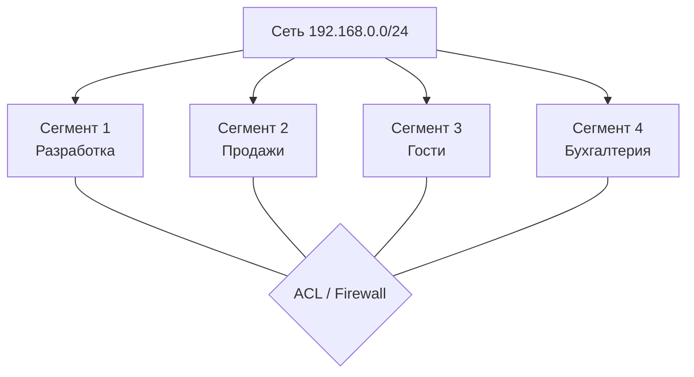

# Сегментация_Сети

> [!abstract] Кратко
> Сегментация — деление сети на логические или физические части. Причины: меньше трафика, меньше broadcast, безопасность, управляемость, независимость логики от физики.

## 1. Зачем нужно
Понять, зачем вообще делить сеть — до VLAN и до масок. Сегментация — цель, маска и VLAN — инструменты.

## 2. Простыми словами
Сегментация — это перегородки в офисе. Каждый отдел в своей комнате. Меньше крика, меньше подслушивания, проще порядок.

## 3. Технические детали

Причины сегментации:

1. **Меньше трафика:** пакеты идут только в нужный сегмент.
2. **Меньше broadcast:** ARP/DHCP не летят во всю сеть.
3. **Безопасность:** гости отдельно, бухгалтерия отдельно.
4. **Управляемость:** малыми частями проще управлять.
5. **Логика отдельно от физики:** VLAN поверх одного коммутатора.
6. **Эффективность:** сумма факторов повышает общую производительность.

Схема: одна сеть → четыре сегмента.



- **Читать схему:** одна физическая сеть делится на сегменты. Между сегментами — контроль (ACL/firewall), а не «всё видит всё».

- **Пример:** 192.168.1.0/24 — разработка, 192.168.2.0/24 — продажи. Между ними — маршрутизатор.
- **Инструменты:** маска (L3-граница), VLAN (L2-граница), ACL (контроль между).

## 4. Пример / команда
Проверка широковещательного домена:

```bash
arp -a             # ARP-таблица
show vlan brief    # коммутатор: какие VLAN есть
```

## 5. Для ИБ

| Риск | Защита |
|------|--------|
| Плоская сеть → боковое перемещение | Сегментация, ACL между сегментами |
| Гостевая сеть в общей VLAN | Отдельная VLAN/подсеть для гостей |
| Broadcast-шторм в большой сети | Малые broadcast-домены |
| Нет контроля между сегментами | Межсегментный firewall/ACL |
| Сегментация без документации | План адресации, схема |

## 6. Вопросы для самопроверки
1. Что такое сегментация?
2. Назови три причины сегментации.
3. Чем маска сегментирует сеть?
4. Чем VLAN сегментирует сеть?
5. Что контролирует трафик между сегментами?

## Связи
- [[Сеть_Подсеть]]
- [[Маска_Подсети]]
- [[VLAN]]
- [[Конфликт_Масок]]
- [[Коммутатор_L2]]
