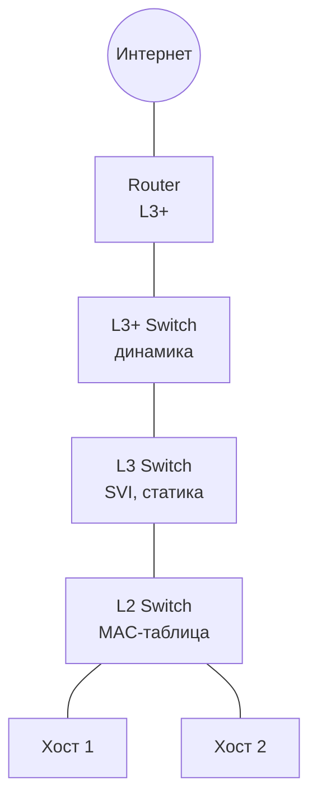

# Сравнение_сетевых_устройств

> [!abstract] Кратко
> Сводная таблица L2 / L3 / L3+ / Router: уровень OSI, задача, маршрутизация, VLAN, QoS, интернет. Плюс границы применения.

## 1. Зачем нужно
Одна таблица вместо четырёх заметок — быстро выбрать устройство под задачу.

## 2. Простыми словами
L2 — внутри LAN. L3 — внутри LAN с VLAN. L3+ — крупная сеть с динамикой. Router — граница с внешним миром.

## 3. Технические детали

| Характеристика | L2 Switch | L3 Switch | L3+ Switch | Router |
|---|---|---|---|---|
| Уровень OSI | 2 | 2 и 3 | 2 и 3 | 3 и выше |
| Основная задача | Коммутация LAN | Коммутация + маршрутизация VLAN | Расширенная маршрутизация | Межсетевое соединение |
| Маршрутизация | Нет | В основном статическая | Динамическая | Динамическая |
| VLAN | Да | Да | Да | Да |
| QoS | Ограниченная | Да | Да | Да |
| Подключение к интернету | Нет | Нет | Да | Да |

Границы применения:

- **L2:** небольшие сети без маршрутизации.
- **L3:** сети с VLAN и умеренной сложностью.
- **L3+:** крупные инфраструктуры с динамикой.
- **Router:** связь LAN с внешними сетями.



- **Читать схему:** сверху вниз — от внешнего мира к хостам. Router — граница, L3+ — динамика, L3 — межвлановый обмен, L2 — доступ хостов.

## 4. Пример / команда
Быстрая проверка типа устройства:

```bash
show version | include uptime
show ip route
```

## 5. Для ИБ

| Риск | Защита |
|------|--------|
| Выбор L2 там, где нужен L3 → плоскость | Оценить VLAN и маршрутизацию заранее |
| L3+ без контроля динамики → подмена маршрутов | Аутентификация OSPF/BGP |
| Router без ACL на WAN | Zone-based firewall, ACL |
| Смешение ролей → сложная диагностика | Явная схема: L2/L3/L3+/Router |

## 6. Вопросы для самопроверки
1. Какой уровень OSI у L2-коммутатора?
2. Чем L3+ отличается от L3?
3. Где нужен router, а не L3+?
4. Какое устройство не подключают к интернету напрямую?
5. Почему QoS ограничен у L2?

## Связи
- [[Коммутатор_L2]]
- [[Коммутатор_L3]]
- [[Коммутатор_L3_Plus]]
- [[Маршрутизатор]]
- [[Коммутация_Маршрутизация]]