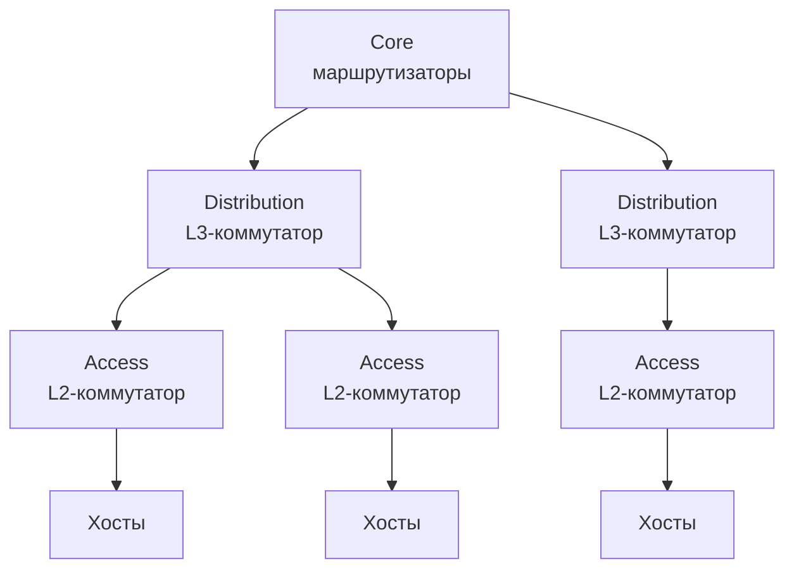

# Трехуровневая_модель_сети

> [!abstract] Кратко
> Классическая архитектура: Access (L2, подключение хостов) → Distribution (L3, маршрутизация между VLAN, ACL, QoS) → Core (маршрутизаторы, передача между агрегационными узлами). Сеть делится на L2- и L3-сегменты.

## 1. Зачем нужно
Понять каркас, на который навешиваются VLAN, маршрутизация и безопасность. Без него всё дальнейшее — куски.

## 2. Простыми словами
Город: дома (хосты) → районы с коммуникациями (Access) → городские магистрали (Distribution) → трассы между городами (Core).

## 3. Технические детали

| Уровень | Устройства | Задачи |
|---|---|---|
| **Access** | L2-коммутаторы | Подключение конечных устройств, коммутация L2 |
| **Distribution** | L3-коммутаторы | Маршрутизация между VLAN/подсетями, ACL, QoS |
| **Core** | Маршрутизаторы | Передача данных между агрегационными узлами |

- **L2-сегмент:** access/trunk-порты, VLAN, маски подсети.
- **L3-сегмент:** маршрутизация трафика между подсетями.

Схема:



- **Читать схему:** сверху вниз — от ядра к хостам. Core связывает Distribution, Distribution маршрутизирует, Access подключает хосты.

## 4. Пример / команда
Проверка ролей устройства:

```bash
show version | include uptime
show ip route          # есть маршруты → L3-роль
show mac address-table # только MAC → L2-роль
```

## 5. Для ИБ

| Риск | Защита |
|------|--------|
| Нет разделения уровней → плоскость | Явная схема Access/Distribution/Core |
| Core без резерва → единая точка отказа | Резервирование, ECMP |
| Distribution без ACL → все VLAN видят друг друга | ACL на SVI |
| Access без Port Security → подмена MAC | Port Security, DAI |

## 6. Вопросы для самопроверки
1. Какие три уровня?
2. Что делает Access?
3. Что делает Distribution?
4. Что делает Core?
5. Где проходит граница L2/L3?

## Связи
- [[Access_vs_Trunk_порты]]
- [[Маршрутизация_на_Distribution]]
- [[Маршрутизация_на_Access]]
- [[Коммутатор_L2]]
- [[Коммутатор_L3]]
