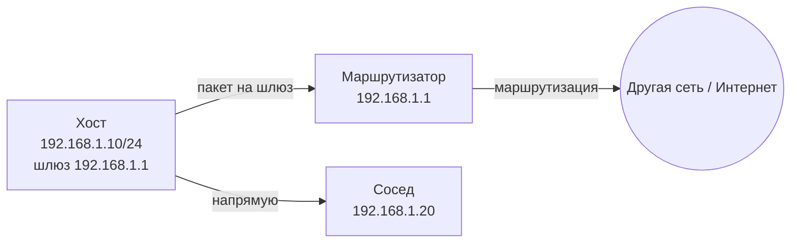

# Шлюз по умолчанию (Default Gateway)

> [!abstract] Кратко
> Шлюз по умолчанию — адрес маршрутизатора, на который хост отправляет пакеты, если получатель не в его подсети. Без шлюза хост видит только свою подсеть. Шлюз — «выход во внешний мир».

## 1. Зачем нужно
Понять, как хост в одной подсети достаёт хост в другой подсети или в интернете. Без шлюза — только соседи по подсети.

## 2. Простыми словами
Ты в квартире. Хочешь написать соседу — просто стучишь в стену (внутри подсети). Хочешь написать в другой город — идёшь на почту (шлюз). Без почты — только соседи по дому.

## 3. Технические детали

- **Что это:** IP-адрес маршрутизатора в той же подсети, что и хост.
- **Зачем:** для пакетов, получатель которых не в подсети хоста.
- **Сколько:** один на интерфейс (обычно).
- **Где настраивается:** в параметрах сетевого интерфейса хоста или выдаётся через DHCP.
- **Что видит хост:** «Если получатель не в моей подсети — отправь на MAC шлюза».

**Как работает:**
1. Хост смотрит на IP получателя и свою маску.
2. Если получатель в той же подсети — шлёт напрямую (через ARP ищет MAC получателя).
3. Если получатель в другой подсети — шлёт на MAC шлюза (ARP ищет MAC шлюза).
4. Шлюз (маршрутизатор) принимает пакет, смотрит свою таблицу маршрутов, отправляет дальше.

**Почему без шлюза не работает:**
- Хост видит только свою подсеть.
- Пакеты в другие подсети отбрасываются: «No route to host» или «Destination host unreachable».

**Проверка:**
- Windows: `ipconfig /all` — строка «Основной шлюз».
- Linux: `ip route` — строка `default via`.
- Cisco: `show ip route` — строка `S* 0.0.0.0/0`.

Схема: хост, шлюз, внешний мир.



- **Читать схему:** сосед в той же подсети — напрямую. Всё остальное — через шлюз.

**Частая ошибка:** шлюз не в той же подсети, что хост. Тогда хост не сможет с ним связаться. Шлюз всегда должен быть «соседом» по подсети.

## 4. Пример / команда
Windows:

```bash
ipconfig /all
# Ищи строку "Основной шлюз"

route print
# Ищи строку 0.0.0.0
```

Linux:

```bash
ip route
# Строка default via 192.168.1.1 dev eth0

ip route add default via 192.168.1.1
```

Cisco:

```bash
show ip route
# S* 0.0.0.0/0 [1/0] via 192.168.1.1
```

## 5. Для ИБ

| Риск | Защита |
|------|--------|
| Подмена шлюза через ARP-спуфинг → перехват трафика (MITM) | Dynamic ARP Inspection (DAI), статические ARP для шлюза |
| Шлюз без аутентификации → любой может объявить себя шлюзом | DHCP Snooping, статические записи |
| Шлюз в общей VLAN с гостями | Отдельная VLAN для гостей, ACL |
| Ошибка в настройке шлюза → потеря связи | Проверка ipconfig / ip route, ping шлюза |

## 6. Вопросы для самопроверки
1. Что такое шлюз по умолчанию?
2. Зачем он нужен?
3. Что произойдёт, если шлюз не настроен?
4. Должен ли шлюз быть в той же подсети, что и хост?
5. Где посмотреть шлюз на Windows / Linux?

## Связи
- [[Протокол_IPv4]]
- [[Маска_Подсети]]
- [[Сеть_Подсеть]]
- [[Маршрутизация]]
- [[Протокол_NAT]]
- [[ARP_в_локальной_сети]]